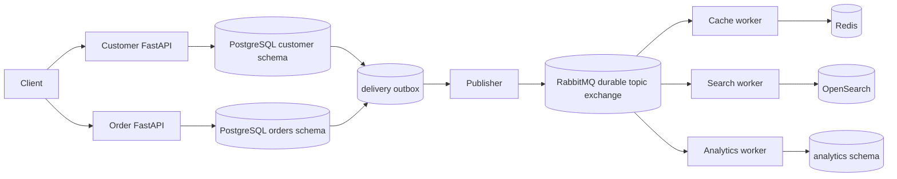
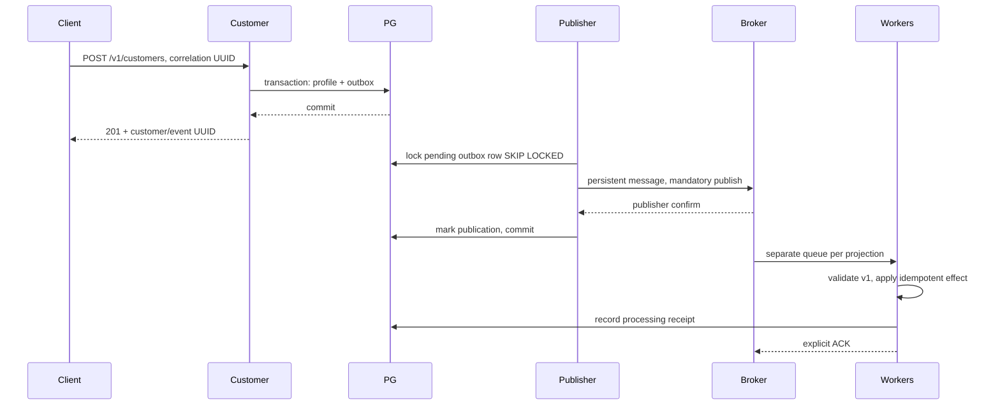
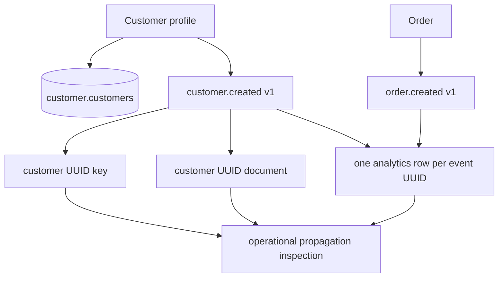
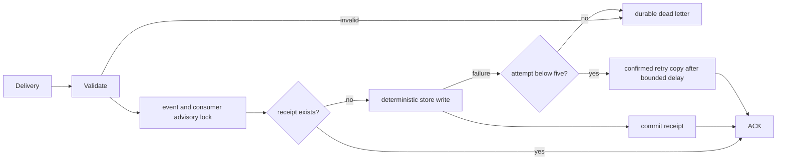
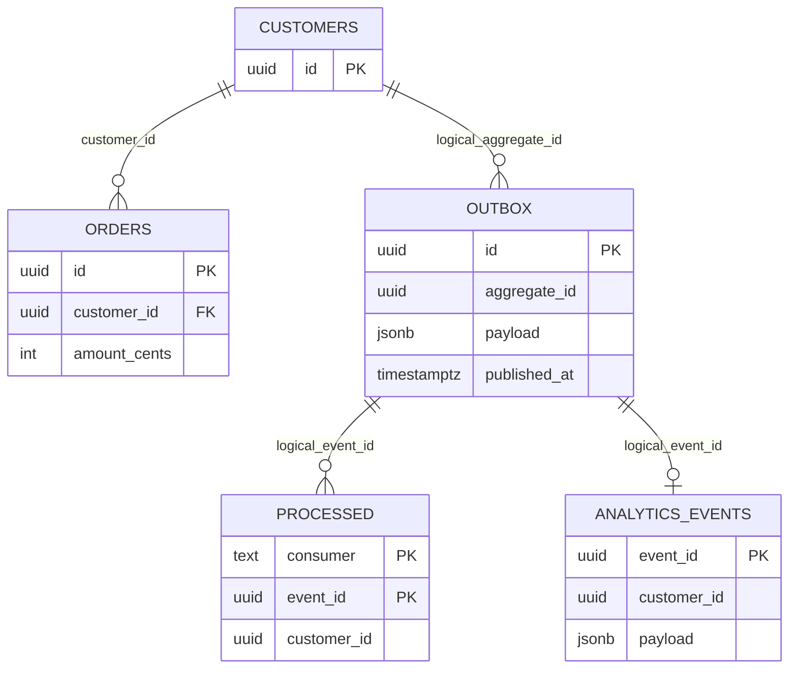
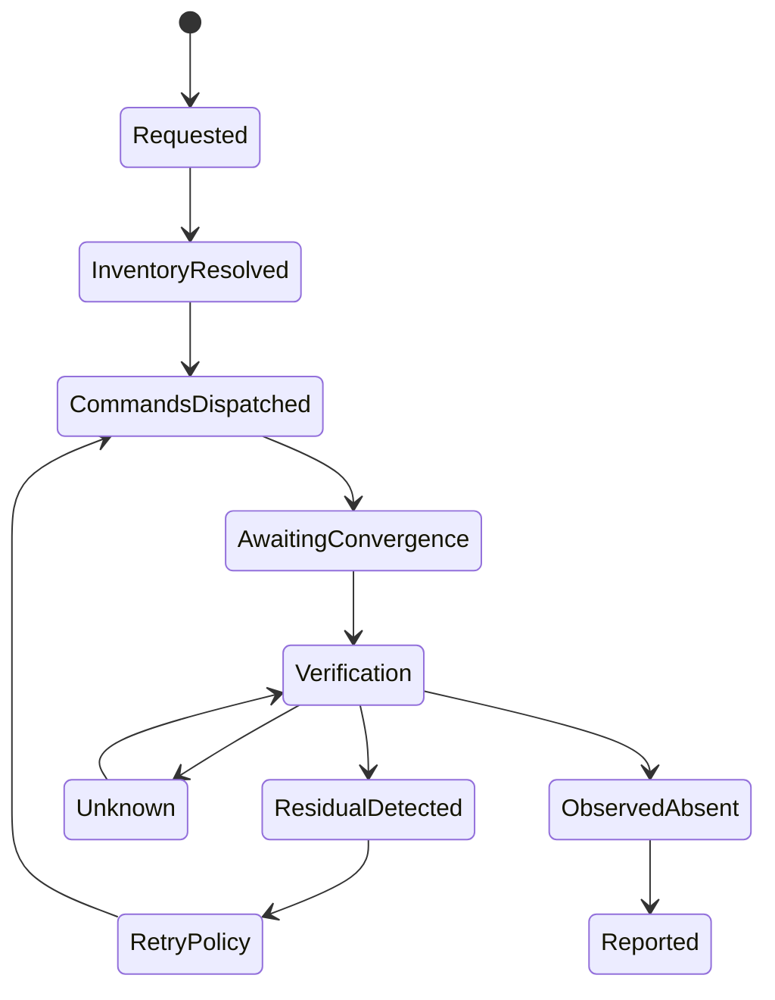

# Architecture and contracts

## High-level

## Microservice interactions

## Data propagation

## Event processing

## Database relationships

Only orders.customer_id is a physical FK. Independent projections deliberately retain logical identifiers without cascading source deletion. Migration ledger is public.schema_migrations. Receipt composite primary key is the idempotency boundary. One shared PostgreSQL instance is a student-resource tradeoff; shared credentials are not a security boundary.

## Planned deletion lifecycle (not implemented)

## Event contract
Event JSON Schema is reproducibly generated by `python scripts/event_schema.py`. Required envelope: event_id UUID, version=1, event_type customer.created/order.created, occurred_at UTC timestamp, correlation_id UUID, customer_id UUID, typed data. Unknown fields and versions reject to DLQ. Producers commit event and source atomically. Stable event IDs survive retries; delivery is at-least-once. No global ordering guarantee. Analytics stores event payloads, including profile copies, intentionally expanding the future deletion inventory.

## Future extension contracts (design only)
Phase 2 deletion command: command_id, request_id, customer_id, store, requested_at, deadline, schema_version. Result: command_id, outcome accepted/applied/failed, retryable, observed_at; applied is not independent proof. A tombstone/version fence must prevent delayed create messages from resurrecting deleted profiles.

Phase 3 adapter input: subject UUID, explicit scope, deadline and correlation ID. Output: adapter name/version, observed_at, state present/absent/unknown, coverage, query fingerprint and evidence reference. Read credentials must be independent of orchestrator acknowledgments; inaccessible stores always yield unknown. Evidence retention must avoid retaining the very PII being deleted. Backup scope, search aliases, replicas and analytics payload copies need explicit coverage. No placeholder engine is shipped.
