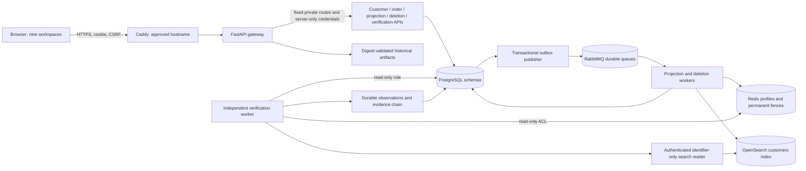
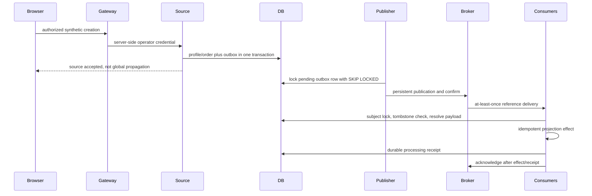
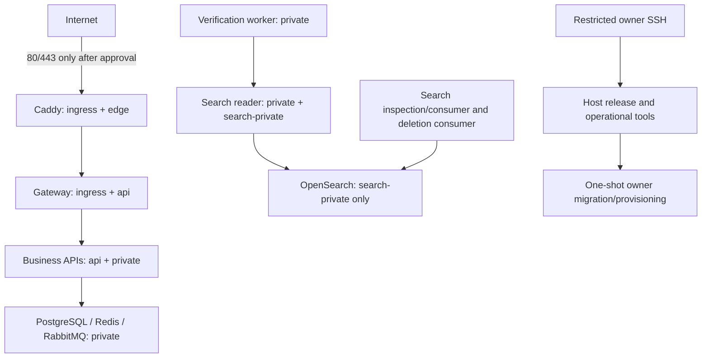

# EraseProof X - architecture and trust boundaries

Generated: 2026-11-08. Tested runtime: `0e115298774c4b79ad4b7ec3aa343dd037700ae1`. Repository: https://github.com/bhuvzzs24-spec/Eraseproof-x.

**Public deployment: BLOCKED / PENDING OWNER APPROVAL. No cloud resources or public HTTPS URL have been created.** Current measured qualification and final source revision are recorded in `Phase-6-Validation.md` and the delivery manifest; a successful local or CI build is not public deployment.

## Actual technology choices

The frontend is React 19, TypeScript, Vite and TanStack Query, with native accessible HTML/SVG and lazy-loaded charts. It is not Next.js. The Phase 5 implementation adapted the suggested stack to an established Python runtime: a FastAPI gateway serves the static production build and same-origin API, so no Node server is needed after building. Python/FastAPI services use PostgreSQL, Redis, RabbitMQ and OpenSearch. No datastore has been replaced with an in-memory simulation.

There are seven business API processes: customer, order, cache inspection, search inspection, analytics inspection, deletion and verification. PostgreSQL hosts multiple schemas in one instance; this is not independent database-per-service isolation. Six verification targets map to three directly probed datastore technologies: customer, orders, analytics and event history share PostgreSQL; cache uses Redis; search uses OpenSearch. RabbitMQ transports references and commands and is not a seventh independently verified deletion target.

## Event and deletion boundaries

A subject advisory lock coordinates supported writes with deletion admission. It does not atomically commit remote stores with PostgreSQL. Redis Lua and OpenSearch external version fences address ambiguous late writes at the store boundary. Direct administrative writes, old clients that ignore fences, unknown copies and backups are outside that guarantee.

## Hosted network layout

`deploy/compose.hosted.yaml` is standalone; it must not be merged with the fault-enabled research overlay. Internal networks have no default external route. The gateway has no datastore network membership. Only selected search writers and the identifier-only reader join the OpenSearch network. The verification worker cannot reach native OpenSearch directly. Search reader authentication is separate and accepts only the implemented UUID GET/search shapes; write and administration methods are rejected.

Only the explicit `publish` profile exposes Caddy ports. CI replaces both port and volume lists with `!override` and binds HTTPS to 127.0.0.1 using its own local CA. Those checks do not establish a publicly trusted certificate or reachable cloud URL.

## Identity and state

Hosted identity uses an owner-maintained file of per-account salted scrypt hashes. Shared role passwords remain available only in the trusted local lab. Hosted sessions are opaque random tokens with hashed server-side records, an hour lifetime, Secure/HttpOnly/SameSite=Strict host-only cookies, exact-origin CSRF checks and revocation after logout, password rotation or role changes. A public demonstration, if deliberately enabled, creates a 15-minute read-only session. It cannot create customers, delete, retry, launch verification or execute faults.

The gateway stores sessions, minute-window request counters and mutation metadata in a persistent SQLite volume. It is a single-host design, not a horizontally scaled session cluster. The business workflows remain durable in PostgreSQL and RabbitMQ. A lost browser connection does not cancel committed deletion work.

## Sources and key boundaries

| Implementation | Responsibility |
|---|---|
| `eraseproof/api.py`, `db.py`, `events.py` | validated source operations, transaction boundaries, migrations |
| `worker.py`, `broker.py`, `lifecycle.py` | outbox, delivery, deduplication, subject fences |
| `deletion.py`, `deletion_worker.py`, `deletion_connectors.py` | durable orchestration and real connector effects |
| `verification.py`, `verification_worker.py`, `verification_adapters.py` | independent probes, repeated observation, evidence publication |
| `verification_models.py`, `policies/scope-v1.json` | outcomes and declared target policies |
| `research_*.py` | controlled experiments, independent fixture oracle, internal baselines, metrics |
| `dashboard_gateway.py`, `hosted_security.py`, `search_reader.py` | browser access and hosted trust boundaries |
| `dashboard_backend.py` | bounded actual SQL read models |
| `frontend/src/operations.tsx`, `research.tsx`, `Charts.tsx` | operational workflows, investigation/research and visualizations |
| `deploy/`, `scripts/hosted_ops.py`, `validate_hosted.py` | deployment package, approval checks and actual CI qualification |

A host administrator and database owner remain trusted. A shared non-owner runtime role is narrower than a database owner but is still shared across business services. This is a meaningful hardening step, not full tenant or service compromise isolation. For real customer data, per-service roles, stronger identity, key management and a complete independent security review remain necessary.
