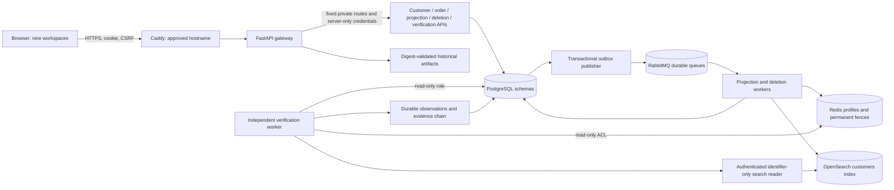
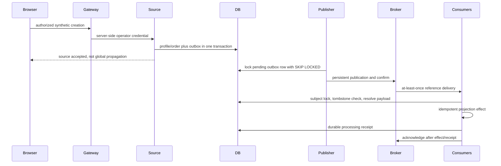
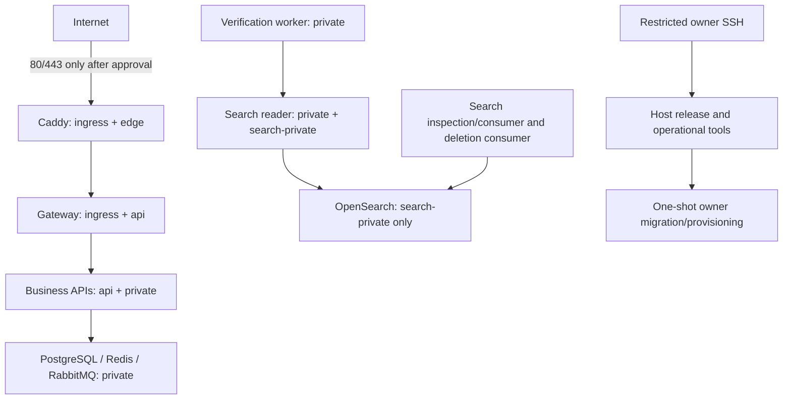
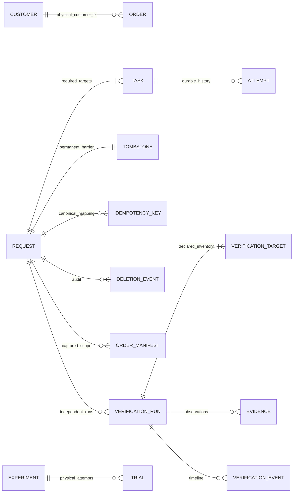
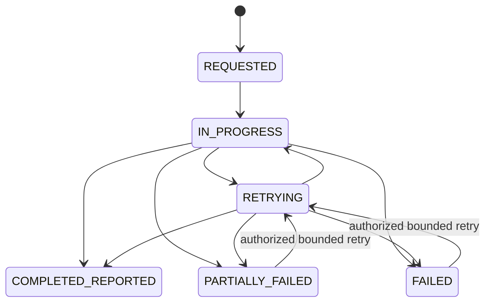
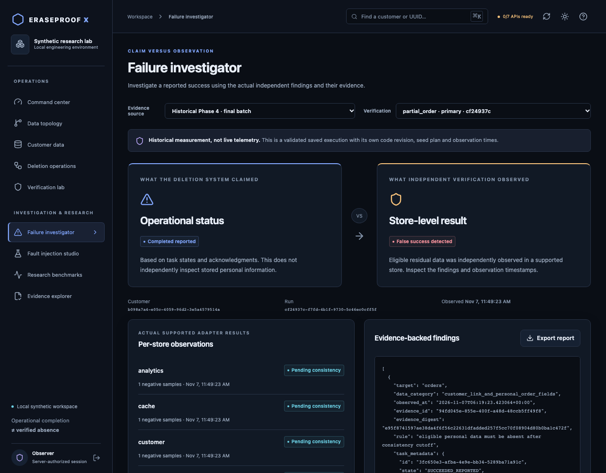
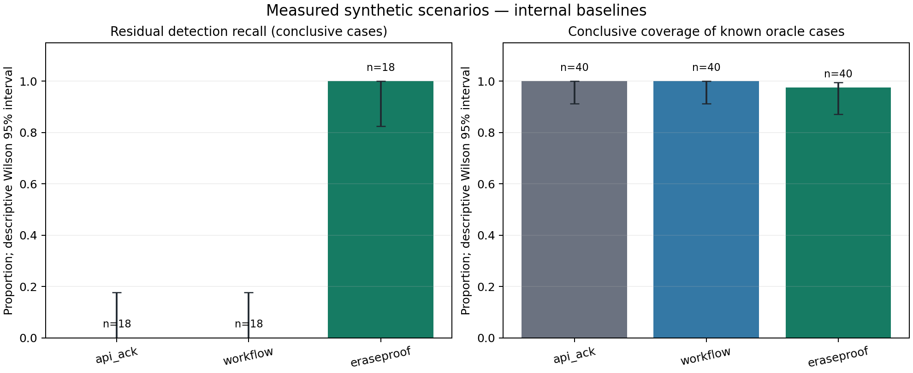
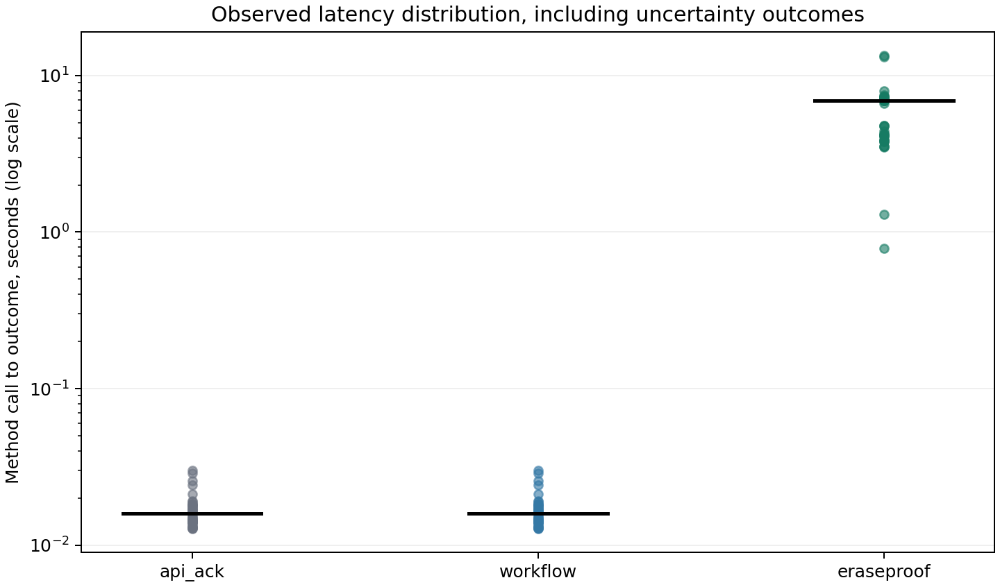

# EraseProof X

# Complete Technical Report

## Distributed deletion claims, independent observations and reproducible evidence

Generated 2026-11-08. Phase 6 tested runtime: `0e115298774c4b79ad4b7ec3aa343dd037700ae1`; corrections and the final tested/source SHAs are recorded in [Phase 6 validation](Phase-6-Validation.md). Repository: https://github.com/bhuvzzs24-spec/Eraseproof-x.

**Deployment: BLOCKED / PENDING OWNER APPROVAL. No cloud resources created and no public HTTPS URL verified.** A prepared deployment package and successful CI are not an actual cloud deployment.

## 1. Project overview

### Abstract

EraseProof X is a research-oriented distributed deletion application that distinguishes an operational deletion claim from independent observations of the supported data stores. It implements real synthetic source services, transactional event delivery, cache/search/analytics projections, durable deletion tasks and retries, store-local resurrection fences, six independent verification targets, sanitized evidence and controlled fault experiments. A nine-workspace React/TypeScript engineering dashboard makes these workflows inspectable. Phase 6 adds a private persistent hosted-demonstration package, stronger hosted identity, safety gates, security qualification, recovery tooling and this complete technical record.

The central question is concrete: after the deletion orchestrator reports completion, does eligible information still exist in any declared supported location? An HTTP success, broker confirmation or task receipt answers a narrower question. EraseProof X deliberately checks the actual store contents through separate adapters and retains uncertainty when it cannot justify a conclusion.

### Problem, motivation and objectives

A customer profile can appear in a source table, an order relationship, a cache value, an index document, analytics JSON and event history. These copies do not share an atomic commit. A service can be unavailable, a message can repeat, a worker can crash after a remote effect or an old event can arrive after deletion. An operator needs to see what the system claims, what was actually observed, when the observation was made and which locations were excluded.

The objectives are to implement a durable observable deletion protocol, inspect real store state independently, detect controlled incomplete deletions, avoid translating errors into success, provide reproducible evaluation and make the evidence understandable to students and engineers. A second objective is an honest deployment story: prepare a useful hosted synthetic application without disguising a static page as a complete service or publishing dangerous controls without approval.

### Scope and users

The application accepts synthetic names and `example.invalid` addresses. Expected users are students studying DBMS/distributed systems, engineers examining deletion reliability, operators demonstrating a synthetic workflow and research administrators running explicitly isolated experiments. It is not a legal-compliance engine, universal discovery platform, physical-media erasure tool or real-customer-data service.

Observable logical absence is bounded by the captured inventory, identifiers, credentials, policies, budgets, store behavior and observation time. Backups, unknown copies, unconfigured replicas, arbitrary exports and future administrative writes remain outside scope. UUIDs, tombstones, manifests and evidence digests can remain linkable metadata. These limitations are part of the product model, not footnotes to a universal-erasure claim.

### Development phases

| Phase | Delivered capability | Evidence boundary |
|---|---|---|
| 1 | source APIs, PostgreSQL schemas/outbox, RabbitMQ delivery, real projections | propagation, not deletion verification |
| 2 | durable six-target deletion orchestration, retries, leases and fences | reported completion, not independent absence |
| 3 | independent adapters, consistency policy, outcomes and sanitized evidence | declared online scope |
| 4 | isolated faults, oracle, internal baselines, measured datasets and analysis | selected synthetic experiments |
| 5 | nine integrated workspaces, real browser workflows and role gateway | actual local/CI runtime, no public hosting |
| 6 | hosted synthetic preparation, identity/network hardening, scans, recovery and final documentation | exact checks recorded separately; cloud publication pending approval |

The actual frontend is React/Vite, not Next.js. The choice reuses the established Python runtime and serves the compiled frontend and API from one origin. No working backend was replaced to simplify the UI.

## 2. Existing systems and research

Deletion orchestration, privacy request automation and data discovery are established fields. The existence of this project does not demonstrate novelty or a competitor defect. Product documentation can establish published interfaces and stated behavior; it cannot replace a controlled comparative evaluation.

[OneTrust's data-subject deletion API](https://developer.onetrust.com/onetrust/reference/deletedatasubjectprofileusingdelete) documents asynchronous deletion and options concerning receipts/transactions. This is relevant context for explicit scope and operational status. EraseProof X did not test OneTrust, Transcend, BigID or Fides as benchmark methods, and it makes no claim that they lack independent verification or are inferior.

RabbitMQ separates [publisher confirms from consumer acknowledgments](https://www.rabbitmq.com/docs/confirms). That transport distinction motivates a separate store observation: accepting a message and applying an effect are different boundaries. OpenSearch's [index API](https://docs.opensearch.org/latest/api-reference/document-apis/index-document/) documents refresh/version semantics relevant to projections. The project uses direct document lookup as well as search; neither is a universal copy inventory.

Cryptographic deletion research addresses different guarantees. [Hao, Clarke and Zorzo, Deleting Secret Data with Public Verifiability](https://eprint.iacr.org/2014/364) studies verifiable encryption/key-deletion operations under hardware assumptions. [Li and Ni's SevDel preprint](https://arxiv.org/abs/2307.04316) combines SGX/blockchain-related mechanisms; its record notes technical problems. Their experiments were not reproduced here. EraseProof X does not implement key destruction, zero-knowledge proofs, SGX attestation or blockchain finality.

[Dynamo's published architecture](https://www.allthingsdistributed.com/files/amazon-dynamo-sosp2007.pdf) is relevant background for availability and consistency tradeoffs. This application does not implement Dynamo's entire replication/conflict-resolution model. Its business schemas share one PostgreSQL instance and its projections converge asynchronously.

The research hypothesis is narrower than a novelty claim: for known online locations under selected controlled failures, direct consistency-aware read adapters can reveal residuals that operational-status monitors do not observe. That hypothesis is evaluated using real stores, known synthetic fixtures, an explicit oracle and retained data. It is not a claim about production accuracy, unknown-copy discovery or commercial superiority.

## 3. Requirements, actors and acceptance criteria

| Requirement | Implemented interpretation |
|---|---|
| Synthetic creation and propagation | source transaction plus outbox; observable real projections |
| Durable deletion | canonical request, complete required task inventory, durable attempts/leases |
| Resurrection prevention | subject locks plus permanent PostgreSQL/Redis/OpenSearch fences for supported writers |
| Independent verification | six real adapters that do not use task success as absence evidence |
| Consistency awareness | eligibility cutoff, repeated negatives, explicit errors/deadlines |
| Evidence | sanitized typed observations, policy/adapter versions and integrity linkage |
| Research | registered local faults, independent fixture reads, raw trials, cleanup and fair internal baselines |
| Dashboard | nine actual connected workspaces with typed errors/polling and exports |
| Authorization | public/readonly, operator and isolated research capabilities enforced server-side |
| Hosting | real resident services and persistent volumes; no public listener before approval |
| Recovery | migration serialization, durable work recovery and scoped restore validation |
| Integrity | preserve failures, distinguish data sources/denominators and avoid unsupported claims |

Readonly users inspect authorized information. Operators create supported synthetic fixtures, delete/retry and run verification. Research administrators can execute registered faults only in an explicitly approved isolated local lab; hosted fault execution is denied regardless of role. Host/migration administration is not a public application role.

The main use cases are normal deletion-to-evidence, investigation of an actual contradiction, consistency delay/reappearance, authorized retry, recorded research exploration and safe deployment/recovery. Nonfunctional goals include bounded work, truthful asynchronous state, usable failure states, accessible desktop/tablet UI, reproducible builds, private stores and source/evidence traceability.

Acceptance depends on observed tests, not the presence of code or screenshots alone. Public deployment additionally requires explicit cost/publication authorization, actual infrastructure, valid public HTTPS, persistent state and remote workflows that continue without the developer computer. Missing approval is recorded as pending, not silently treated as complete.

## 4. Complete architecture and trust boundaries

### Actual technology choices

The frontend is React 19, TypeScript, Vite and TanStack Query, with native accessible HTML/SVG and lazy-loaded charts. It is not Next.js. The Phase 5 implementation adapted the suggested stack to an established Python runtime: a FastAPI gateway serves the static production build and same-origin API, so no Node server is needed after building. Python/FastAPI services use PostgreSQL, Redis, RabbitMQ and OpenSearch. No datastore has been replaced with an in-memory simulation.



There are seven business API processes: customer, order, cache inspection, search inspection, analytics inspection, deletion and verification. PostgreSQL hosts multiple schemas in one instance; this is not independent database-per-service isolation. Six verification targets map to three directly probed datastore technologies: customer, orders, analytics and event history share PostgreSQL; cache uses Redis; search uses OpenSearch. RabbitMQ transports references and commands and is not a seventh independently verified deletion target.

### Event and deletion boundaries



A subject advisory lock coordinates supported writes with deletion admission. It does not atomically commit remote stores with PostgreSQL. Redis Lua and OpenSearch external version fences address ambiguous late writes at the store boundary. Direct administrative writes, old clients that ignore fences, unknown copies and backups are outside that guarantee.

### Hosted network layout



`deploy/compose.hosted.yaml` is standalone; it must not be merged with the fault-enabled research overlay. Internal networks have no default external route. The gateway has no datastore network membership. Only selected search writers and the identifier-only reader join the OpenSearch network. The verification worker cannot reach native OpenSearch directly. Search reader authentication is separate and accepts only the implemented UUID GET/search shapes; write and administration methods are rejected.

Only the explicit `publish` profile exposes Caddy ports. CI replaces both port and volume lists with `!override` and binds HTTPS to 127.0.0.1 using its own local CA. Those checks do not establish a publicly trusted certificate or reachable cloud URL.

### Identity and state

Hosted identity uses an owner-maintained file of per-account salted scrypt hashes. Shared role passwords remain available only in the trusted local lab. Hosted sessions are opaque random tokens with hashed server-side records, an hour lifetime, Secure/HttpOnly/SameSite=Strict host-only cookies, exact-origin CSRF checks and revocation after logout, password rotation or role changes. A public demonstration, if deliberately enabled, creates a 15-minute read-only session. It cannot create customers, delete, retry, launch verification or execute faults.

The gateway stores sessions, minute-window request counters and mutation metadata in a persistent SQLite volume. It is a single-host design, not a horizontally scaled session cluster. The business workflows remain durable in PostgreSQL and RabbitMQ. A lost browser connection does not cancel committed deletion work.

### Sources and key boundaries

| Implementation | Responsibility |
|---|---|
| `eraseproof/api.py`, `db.py`, `events.py` | validated source operations, transaction boundaries, migrations |
| `worker.py`, `broker.py`, `lifecycle.py` | outbox, delivery, deduplication, subject fences |
| `deletion.py`, `deletion_worker.py`, `deletion_connectors.py` | durable orchestration and real connector effects |
| `verification.py`, `verification_worker.py`, `verification_adapters.py` | independent probes, repeated observation, evidence publication |
| `verification_models.py`, `policies/scope-v1.json` | outcomes and declared target policies |
| `research_*.py` | controlled experiments, independent fixture oracle, internal baselines, metrics |
| `dashboard_gateway.py`, `hosted_security.py`, `search_reader.py` | browser access and hosted trust boundaries |
| `dashboard_backend.py` | bounded actual SQL read models |
| `frontend/src/operations.tsx`, `research.tsx`, `Charts.tsx` | operational workflows, investigation/research and visualizations |
| `deploy/`, `scripts/hosted_ops.py`, `validate_hosted.py` | deployment package, approval checks and actual CI qualification |

A host administrator and database owner remain trusted. A shared non-owner runtime role is narrower than a database owner but is still shared across business services. This is a meaningful hardening step, not full tenant or service compromise isolation. For real customer data, per-service roles, stronger identity, key management and a complete independent security review remain necessary.

## 5. Database design and DBMS concepts

### Logical schemas and retained records

PostgreSQL hosts the source, delivery, deletion, verification and research schemas. These are logical namespaces on one instance, not independently administered databases. The migration ledger is in `public`. Gateway authentication state is separately held in SQLite on a persistent volume.

| Table | Main purpose and important constraint |
|---|---|
| `customer.customers` | profile UUID PK, bounded synthetic name and unique `example.invalid` address |
| `orders.orders` | order UUID, nullable customer FK after migration 2, positive amount and fixed currency |
| `delivery.outbox` | stable event UUID, aggregate/type/JSON payload, publication/retry/cancellation metadata |
| `delivery.processed` | composite consumer/event identity for deduplication and customer-linked receipts |
| `analytics.events` | event UUID and customer-linked JSON projection |
| `deletion.requests` | canonical unique customer request, constrained state and bounded manual retry rounds |
| `deletion.idempotency_keys` | hashed key to canonical request; raw caller key not retained |
| `deletion.tombstones` | permanent customer barrier, monotonic lifecycle and no deletion trigger |
| `deletion.tasks` | exactly configured target vocabulary; unique request/target; active attempt and lease |
| `deletion.attempts` | unique task/attempt number, dispatch/start/finish/outcome and safe failure code |
| `deletion.events` | append-only sequenced audit with request/task correlation and fixed actor labels |
| `deletion.order_manifest` | captured known order IDs retained for later independent field checks |
| `deletion.scope_captures` | evidence that the declared order scope was captured at admission |
| `verification.runs` | policy JSON/digest, run state/result, round/message generation, deadline and lease |
| `verification.targets` | one target per run, result, negative streak, failure count and cutoff anchor |
| `verification.evidence` | sanitized canonical per-target observations and predecessor/digest fields |
| `verification.timeline` | sequenced append-only control/observation events |
| `research.experiments` | source/configuration/environment metadata and experiment state |
| `research.trials` | physical attempts and customer/phase observations, including failed/interrupted runs |
| `research.leases` | project execution ownership and expiry |
| `research.fault_leases` | reversible fault/watchdog ownership token per project/service |
| `public.schema_migrations` | numbered migration versions applied under an advisory transaction lock |

SQLite holds `sessions`, `limits` and `access_audit`. Sessions contain a token digest, role, CSRF value, expiry and account credential version. Quotas contain minute-window counters keyed by hashed identity. Audit stores time, account identifier, method, bounded path and status; it does not store passwords, request payloads or CSRF values.



This diagram summarizes relationships. Not every customer/event/manifest UUID is a physical FK. Independent projections and retained metadata deliberately cannot all cascade away with the profile; exact DDL is authoritative in migrations 001-004.

### ACID transactions, constraints and indexes

Atomicity means the source row and its outbox record commit together or neither does. Consistency means constraints reject invalid states/relationships, not that remote projections are instantly equal. Isolation controls concurrent SQL interactions; explicit row/advisory locks protect additional application invariants. Durability means committed state survives supported process restarts when the datastore storage remains intact; it is not a guarantee against every storage disaster.

The customer FK prevents an eligible linked order from being silently stranded by source deletion. The connector clears the link while retaining whitelisted facts. Primary and unique keys prevent duplicate logical identity. CHECK constraints restrict target/state/currency/retry values. Append-only/monotonic triggers reject ordinary updates that would rewrite audit history or reverse a tombstone. A trusted owner could disable those controls; this is not a malicious-administrator-proof database.

Indexes cover source/aggregate lookup, pending outbox publication, customer-linked receipts/analytics, request state, due tasks, leases, verification scheduling/history and experiment/trial selection. `FOR UPDATE SKIP LOCKED` lets competing schedulers avoid taking the same pending row. It is not an ordering guarantee or a reason to assume a skipped task no longer exists.

[PostgreSQL's locking documentation](https://www.postgresql.org/docs/18/explicit-locking.html) distinguishes transaction/session advisory locks. The implementation uses a transaction-level subject lock for cooperating writes and a session-level run lock to prevent simultaneous duplicate verification rounds. These locks protect shared PostgreSQL coordination; they do not create a distributed atomic commit with Redis or OpenSearch.

### Migration and retention strategy

`db.migrate()` acquires a transaction advisory lock, creates/checks the migration ledger and applies unapplied numbered files before committing. A failing pending migration batch rolls back rather than marking an incomplete version applied. Resident APIs/workers do not run arbitrary DDL or receive owner credentials in the hosted package. The release procedure pauses application work, backs up and runs explicit one-shot owner migration/provisioning jobs.

The synthetic policy retains order facts, UUID manifests, audit/timeline data and exact erasure markers. These are explicit exclusions from eligible profile data, not legal anonymity. Removing all tombstones as generic cleanup would undermine resurrection protection. Backup retention and restoration must account for old profiles and fences; online verification does not inspect physical media or backup copies.

## 6. Distributed deletion orchestration

### Admission and durable state

`deletion.submit()` validates a supported synthetic subject, hashes the idempotency key, acquires the subject barrier and resolves or creates the canonical request. It captures known orders/scope and creates the six target tasks and a permanent tombstone in a transaction. The unique customer request and key mapping make repeated admission converge to the canonical workflow rather than creating unrelated destructive generations.

The scheduler records an attempt, current generation, lease and outbox command atomically. The outbox publisher confirms durable broker publication before marking the SQL record sent. A stable attempt/event identity survives redelivery. The deletion worker checks that a command still owns the current task generation before executing it.



The exact transition guards are in SQL and Python. `COMPLETED_REPORTED` requires the complete configured task inventory to report success. It remains an orchestration statement. It does not automatically become a verification result.

### Real connector effects

| Target | Actual operation | Intentionally retained material |
|---|---|---|
| customer | remove source profile after dependencies | separate tombstone/audit metadata |
| orders | clear customer link; retain permitted facts | order UUID, amount, currency and time |
| cache | atomic erasure fence plus profile removal | exact subject erasure marker |
| search | replace eligible document with exact sentinel at version 2 | UUID/sentinel/version fence |
| analytics | remove customer-linked payload copies | no implemented aggregate table exemption |
| event history | remove source payload records and eligible receipts | strict identifier-only control/receipt metadata by policy |

Source removal depends on required order and event-history work. Failure does not become an empty successful result: errors receive safe codes, retryable operations remain bounded and dependency failures remain visible. Physical order facts with cleared links still require policy-aware field verification; a hidden personal field is not justified by the null link alone.

### Acknowledgments, retries and leases

The worker records RUNNING, performs the connector under its subject protocol, records outcome durably and acknowledges the delivery. A crash after a remote effect but before receipt/outcome commit can repeat the effect. Correctness therefore depends on idempotent SQL deletion, Redis Lua and versioned search replacement, not merely a deduplication flag.

Retries use persisted exponential backoff, a bounded automatic cycle and a bounded manual retry budget. The normal configuration uses three automatic attempts and permits at most three manual rounds. Dispatch/running leases allow the scheduler to recover abandoned work. Obsolete command generations cannot execute a new attempt. Manual retry reissues only eligible failed targets; successful tasks are not silently repeated as a fresh whole workflow.

A heartbeat indicates liveness, not successful progress. Queue delay counts against leases; sustained backlog can exhaust a small demonstration policy and require investigation. The implementation does not provide unlimited retries, arbitrary cancellation, exactly-once transport or an enterprise fairness scheduler.

### Preventing resurrection

All supported cooperating customer-linked writers take the same subject lock and check the tombstone. If a write wins first, deletion waits and subsequently removes it. If deletion wins first, later projection/order writes reject or skip. Redis additionally checks a permanent store-local marker atomically. OpenSearch uses create version 1 and erasure version 2 so a delayed create cannot overwrite the sentinel.

A PostgreSQL lock alone cannot stop a remote request that was already sent and timed out ambiguously. Store-local fencing handles that class of late arrival. It does not stop a malicious administrator, an unknown legacy client or a copy in an unconfigured location. Raw legacy broker payloads, dead letters and backups are not independently erased by these six online targets.

## 7. Independent deletion verification engine

### Separation from orchestration

The verifier does not call deletion connectors or accept task acknowledgments as absence proof. It uses a read-only PostgreSQL probe role, a key-scoped Redis identity and, in hosted mode, a separately authenticated search reader on a network inaccessible to the verifier's direct write path. A separate coordinator identity writes run/target/evidence control state. The owner/host remains trusted; separation is practical least privilege, not cryptographic independence from administration.

### Six actual adapters

| Adapter | Independent observation | Coverage condition |
|---|---|---|
| customer | parameterized source UUID lookup | declared source table reached and query completed |
| orders | current linkage plus captured order IDs; complete row/field policy | manifest/scope and permitted fact whitelist evaluated |
| cache | bounded SCAN over declared subject namespaces, TYPE/GET | no incomplete scan silently interpreted as absence |
| search | real-time UUID document GET plus linked identifier search | hit completeness, shard/timeout state and exact sentinel version checked |
| analytics | direct linkage and recursive exact UUID JSON match | supported table/payload scope covered |
| event history | linked outbox/receipt reads and strict safe envelope classification | unexpected payload fields are not automatically permitted metadata |

The Redis adapter can find derived keys within the declared patterns, not arbitrary key namespaces. Search can find alternate matching document IDs through the configured identifier fields, not arbitrary indices. Orders can expose an unexpected personal field even after the customer FK was cleared. The scope is explicit and finite.

### State, result and algorithm

Run state (`QUEUED`, `RUNNING`, `WAITING`, `FINISHED`) and result are separate axes. A finished run may be inconclusive. A pending target is not a failure to render a green badge; it means the consistency requirement has not yet been satisfied.

```text
accept authorized verification request with an idempotency key
capture versioned policy and digest; create every required target
persist a run/message generation and deadline
for each scheduled round within budgets:
    reject stale or duplicate generations
    obtain the cross-process run lock
    read each actual supported target with the declared read identity
    read current orchestration status only for cutoff/contradiction context
    for every target:
        preserve raw outcome and coverage/error metadata
        apply consistency eligibility and repeated-negative rules
        reset/advance negative streak and probe-error budget correctly
        append sanitized canonical observation and predecessor linkage
    aggregate target results using the declared required inventory
    finish on a justified terminal verdict, otherwise schedule a later round
on expired lease/deadline/round budget:
    retain explicit uncertainty; never manufacture successful absence
```

The current probes are sequential within a round; they are not a simultaneous distributed snapshot. The default policy has a three-second grace period, two required eligible negative observations, two-second interval, 90-second deadline, eight-round limit, bounded probe errors and a 30-second run lease. The captured policy is authoritative for a run; extended observation is a distinct supported profile.

A negative sample must begin after the eligible cutoff; a request started earlier but completed later is not automatically eligible. The prior cutoff anchor/streak matter, so a changed operational boundary cannot inherit an unrelated successful negative streak. Errors and incomplete scope remain explicit. Observation timestamps, not just a final status, are retained.

### Outcomes and a real example

- `VERIFIED_ABSENT`: every required supported target meets the captured negative-observation policy.
- `RESIDUAL_DATA_DETECTED`: eligible data is independently observed without a completed operational claim.
- `FALSE_SUCCESS_DETECTED`: residual evidence contradicts reported operational completion.
- `PENDING_CONSISTENCY`: more eligible observations or timing are required.
- `INCONCLUSIVE`: errors/budgets prevent a supported conclusion.
- `UNSUPPORTED`: required adapter/policy coverage is unavailable.

Actual saved cache/search false-ack experiments show `COMPLETED_REPORTED` while the independent adapter reports residue. Other targets can remain pending when the contradiction terminates the run. The correct explanation is “this residual disproves the completion claim within the checked scope,” not “all other targets were proved absent.” Subsequent authorized cleanup and fresh verification produce a new report; the old finding is not rewritten.

### Evidence and limits

Canonical sanitized records include run/request/correlation IDs, target, adapter/version, policy/version/digest, query category, probe/observation time, raw and policy-adjusted outcomes, scope completeness, safe summary/error code, command count, duration and operational task metadata. They do not export source names/emails or raw profile payloads. A predecessor/digest chain and export integrity check detect certain retained-record alterations.

Hashes do not prove physical erasure or protect against a host/database administrator who can rewrite a chain and its trust anchor. A correct negative result is conditional on the policy, credentials, read path and time. Reappearance after that time remains possible; the framework demonstrates it and can detect it with a later independent run.

## 8. Fault injection and benchmark framework

The research subsystem is a separate explicitly opted-in local execution path. A harness validates a local Docker engine, known project, isolation labels and loopback bindings before destructive fault administration. Project leases prevent colliding runs; fault leases/watchdogs help restore bounded interruptions. The hosted gateway has no Docker socket and rejects fault execution even for a research role.

The versioned scenario catalog contains normal retention and controlled false acknowledgments, analytics/order residue, cache/verification unavailability, delayed reappearance, duplicate/reordered delivery, pending delivery, ambiguous responses, missing capability, worker crash, database transaction interference, concurrent order/deletion and multiple residuals. These are controlled synthetic failure models, not evidence of malicious cloud behavior.

```mermaid
flowchart LR
 Plan[Versioned matrix + seed + source revision] --> Guard[Local isolation and project lease]
 Guard --> Fixture[Create real synthetic workload]
 Fixture --> Fault[Registered bounded real fault]
 Fault --> Claim[Actual orchestration metadata]
 Claim --> Oracle[Independent privileged fixture reads]
 Oracle --> Methods[Internal monitors and real verifier]
 Methods --> Journal[Physical trial + phase observations + errors]
 Journal --> Cleanup[Separate restoration and cleanup]
 Cleanup --> Export[Digest-validated raw data, evidence and analysis]
```



The oracle reads controlled locations separately and brackets observations where needed. Unknown ground truth is retained when transitions or access prevent a defensible label. Evaluated methods receive neither oracle answers nor expected scenario labels. The oracle and verifier still share a synthetic specification and administrative infrastructure; this limits independence and external validity.

The runner records logical plan entries and physical attempts separately. It retains errors, timeouts, interruptions, workload tiers, seeds, source/config/catalog digests, fault transitions, cleanup and resource observations. A failed harness batch is not relabeled a successful experiment; initial and corrected batches remain separate. The reporter validates dataset digests and recomputes summaries before charting. Counts/structure remain exact; only floating roundoff across Python/libm versions has a tightly bounded tolerance.

There is no implemented automatic failure minimizer. Reproducing a named scenario is not delta debugging. Larger/extended workloads, arbitrary new stores, WAN/cloud schedules, backup-aware verification and formal unseen-failure holdouts remain future work unless a specific retained execution establishes them. A new seed for a known scenario must not be marketed as an independent new failure model.

## 9. Frontend and user experience

### What an answer means

A deletion task can finish while a copy remains. The interface separates the deletion system's claim from independent store observations. `Completed reported` is blue operational metadata. `Verified absent - scoped` is a statement about the declared stores and observation time, not universal or permanent erasure. Pending, inconclusive and unsupported are not successful absence.

### Access

The trusted local lab uses the role passwords generated in `.dashboard.env`. The hosted package uses an individual username, account password and server-enforced role. Choosing a role does not grant it: the account record must match. A public read-only entry button appears only when the owner deliberately enables it. It creates an expiring read-only session, not an operator account. Privileged keys never enter browser storage; only the color theme is saved locally.

| Role | Available actions |
|---|---|
| Read-only/public demo | inspect authorized live synthetic state, architecture, historical results and sanitized reports |
| Operator | create synthetic fixtures/orders, request deletion, bounded retries, independent verification and exports |
| Research administrator | operator actions and isolated local-lab research when explicitly enabled; hosted faults are always disabled |

No production customer information belongs in this application. Source names must begin with `Synthetic ` and emails must use `example.invalid`. Random IDs are still pseudonymous identifiers, not proof of anonymity.

### Nine workspaces

1. **Command center:** actual live source counts, operational states, verification outcomes, findings, readiness and recent activity. A dash means unavailable/unobserved, not zero. Counts of requests and runs are different denominators and must not be read as a single success rate.
2. **Data topology:** select declared components to inspect role, categories, adapters and assumptions. Lines are architecture metadata, not live trace traffic. Some components have no separate live probe.
3. **Customer data explorer:** create an authorized synthetic fixture, inspect actual propagation and known order/metadata footprints, optionally add an order, then explicitly confirm deletion. A cleared link alone is not proof that every personal field was removed.
4. **Deletion operations:** filter requests, inspect six tasks, failures, durable attempts and the audit timeline. Retry only eligible failed tasks within the server budget. Tombstone admission cannot be undone as a harmless UI cancellation.
5. **Verification lab:** choose a request and default or extended consistency policy, start a real asynchronous run, follow target outcomes, inspect the captured scope and rerun with a new request key if appropriate.
6. **Failure investigator:** compare what orchestration reported against independent observations. A residual can terminate a run while other targets remain pending; that is a valid contradiction, not six verified negatives.
7. **Fault injection studio:** read registered scenarios and expected protocol labels. In an approved isolated local lab, confirm and execute the actual bounded runner. Hosted/public execution is denied even for a research account.
8. **Research benchmarks:** choose a labeled historical batch, actual live experiment or authorized local job. Inspect internal baselines, confusion matrices, intervals, coverage, sample sizes, timing, query counts, trials and reproduction metadata.
9. **Evidence explorer:** choose a run, filter target/outcome/digest or observation text, expand details and download JSON. Policy/adapter versions, time, scope completeness and evidence linkage matter as much as the outcome badge.

### Normal workflow

Inspect topology and actual readiness. Create a synthetic customer and wait for real cache/search/analytics propagation. Add an order if demonstrating retention. Request deletion and watch it converge to its actual reported state. Start verification; an HTTP 202 means accepted/queued, not completed. Wait for the finished outcome. Inspect all six supported target results and exclusions. Export the sanitized report and retain its run/policy IDs. A successful source deletion response alone is not the final answer.

If the connection fails during a write, do not repeatedly click create/delete. Refresh actual state first. Customer creation has no cross-request idempotency key; repeated requests can create different synthetic customers. Deletion and verification use server idempotency semantics. Mutation retries are not automatic.

### False-success demonstration

Use the saved actual `false_ack_cache` or `false_ack_search` case for public explanation. Show `COMPLETED_REPORTED` beside `FALSE_SUCCESS_DETECTED`, then open the real sanitized residual finding and fault timeline. Explain that the baseline trusts operational metadata while independent adapters read the stores.

To execute a new fault, use a separate explicitly marked local research project, not the hosted stack. The runner creates its own fixtures, applies the registered real fault, runs deletion/verification, saves results and restores/cleans fixtures. Saved evidence is a pre-cleanup observation. A new live check after cleanup can legitimately differ; never rewrite the saved report to hide that distinction.

### Reading uncertainty and limits

- Pending consistency: the required cutoff or repeated negative observations have not yet been satisfied.
- Inconclusive: errors, time/round budgets or incomplete observations prevent a conclusion. It is not absence.
- Unsupported: an adapter/scope is unavailable under the selected policy. It is not a healthy target.
- Residual detected: eligible data was observed in scope. If orchestration claimed completion, the contradiction is classified as false success.
- Verified absent: all required supported targets meet the captured policy in that run. Backups, unknown stores and future administrative writes remain outside the claim.

Live lists are bounded; run pickers show at most 100 recent records. Direct links retain an explicit linked-run option while the list loads or when the run is outside the page. Research job-source labels can lag by one five-second poll. Narrow tables scroll internally; use the light/dark toggle, keyboard focus and reduced-motion settings as needed. Sign out on shared machines.

### Demonstration walkthrough for an interview

Open the topology and explain outbox delivery. Create one synthetic profile and show propagation. Delete it, deliberately pause at `Completed reported`, and explain why this is only a claim. Run independent verification and explain grace/repeated observations. Open a saved actual false-success case and compare the two panels. Filter and export evidence. End with one limitation: this checks declared online logical scope, not backups or physical erasure. Do not claim an online URL or public cloud execution unless the deployment validation report actually records one.

### Actual screenshot evidence



The image above is an actual Phase 6 local viewport inspecting a retained Phase 4 execution. Its historical-data banner and unavailable live services are preserved; it is not a current cloud execution. Current hosted CI captures, if qualification succeeds, are included with their run/source metadata in the final validation collection. All nine workspaces have actual desktop/tablet captures; the screenshot collection labels local unavailable states, historical artifacts and real Docker-backed executions separately.

The design uses reusable neutral dark/light tokens, restrained blue/cyan/amber/green states, semantic text labels, accessible dialogs and forms, keyboard focus, table regions and reduced-motion support. TanStack Query keeps server state in memory, cancels obsolete reads and invalidates after mutations. Historical artifacts are cached separately from live polling. Session expiry clears authenticated client state. Heavy chart code is lazy-loaded. There is no privileged token in localStorage.

## 10. Algorithms and technical foundations

### Distributed state and eventual consistency

Different services can observe different states because the source, broker, workers and projections progress at different times. Eventual convergence is a useful system objective, not a promise that any arbitrary read is immediately authoritative. In this project a source 201 can precede cache/search/analytics propagation. The UI therefore shows observed location state and uncertainty rather than inventing global atomic success.

### ACID versus asynchronous effects

The source row and outbox event share one SQL transaction. That local atomicity solves one dual-write boundary. Broker publication and remote effects occur later and can repeat. A transaction cannot be made global by calling Redis while a SQL connection is open. The subject lock and store fences address specific races without claiming two-phase commit.

### Idempotency and deduplication

Idempotency means repeating the same logical action does not create an additional unsafe effect. A stable request key maps to canonical deletion work; consumer receipts identify processed deliveries; task attempts have generations. A receipt alone is insufficient if a remote effect occurs before its recording. The target effect must itself tolerate retry.

### Acknowledgment and asynchronous processing

Publisher confirmation establishes a broker boundary. Consumer acknowledgment establishes a delivery-processing boundary. Neither independently checks all copies. The publisher/consumer code separates these events; deletion and verification also retain durable SQL state so a browser session is not the workflow owner.

### Deletion versus logical absence

Removing a source row is one operation. Clearing customer linkage while retaining approved order facts is another. Replacing an index document with an exact fence is another. The policy defines which logical material is eligible and which metadata may remain. These operations do not establish physical bit destruction, legal anonymization or deletion from backups.

### Retry policy and recovery

A retry budget prevents unbounded work; exponential delay reduces repeated immediate pressure. A durable lease lets another scheduler recover an abandoned generation. A generation check prevents an old delivery from executing a new attempt. Exhaustion is a visible failure/inconclusive state, not a reason to fabricate completion.

### Resurrection and fencing

A delayed create can reintroduce data after an ordinary delete. The PostgreSQL tombstone rejects cooperating new writes; Redis Lua consults an atomic permanent marker; external search versions reject older creates. These mechanisms cover the implemented writer protocol, not every administrative or legacy writer in the world.

### Independent evidence

A verifier reads supported stores through separate adapters and records exactly what it could observe. A count of zero is meaningful only if the intended scope was reached and the observation is eligible. An access error is not a zero. Evidence must include time, versions and limitations so another engineer can understand the claim.

### Metrics and uncertainty

For conclusive predictions against known binary truth, precision is TP/(TP+FP), recall is TP/(TP+FN) and false-positive rate is FP/(FP+TN). Coverage is conclusive known-truth decisions divided by all known-truth observations. Full-positive detection yield uses all known positives, including positive abstentions in its denominator. Unknown truth is a separate category; it must not quietly become absent.

The Wilson interval in `research_metrics.py` uses the binomial proportion, normal quantile and finite-sample adjustment. An interval is undefined for a zero denominator. A 100% point estimate over 18 cases can still have a wide interval; correlated phases and selected failures further limit population interpretation. The paired exploratory comparison is not a commercial superiority test.

### Evidence integrity versus proof

Canonical JSON and a SHA-256 predecessor chain make certain accidental/unauthorized record changes detectable relative to retained anchors. They do not attest to store hardware, protect against a malicious trusted administrator or prove that a never-inventoried backup was erased. Strong engineering includes naming the property that was actually checked.

## 11. Testing and evaluation

### Test layers and current qualification

The local Phase 6 candidate passed 89 backend unit tests, 16 frontend tests, six Chromium browser checks, lint, type checking, formatting and a production build. Unit tests include per-account hashes, Secure cookie behavior, role escalation denial, account-change revocation, Origin/CSRF/host checks, streamed body limits, durable quotas, read-only search boundaries and publication/network contracts.

Real CI preserves the 29-test Docker regression suite, executable verification demonstration, complete seeded matrix and actual browser customer/deletion/verification/export/fault journeys. The new hosted job separately tests rendered private configuration, native stores, local CA validation, per-account/public boundaries, PostgreSQL backup restoration, service restarts, fresh post-restart verification and hosted browser flows. Security jobs retain actual dependency/source/container results. Exact final counts, failed attempts and nonexecuted checks are in the generated validation record; no draft assumption is a pass.

The first Phase 6 hosted attempt exposed an IPAM allocation conflict with the trusted proxy's reserved address. The first scanner setup assumed a runner utility that was absent. Corrections reserve a separate dynamic address range and verify the publisher checksum using Python. Those initial failures remain identified in validation, rather than becoming silent skips.

### Actual Phase 6 hosted qualification

At runtime `0e115298774c4b79ad4b7ec3aa343dd037700ae1`, the separate real hosted CI stack passed six groups covering unauthorized/public-guest restrictions, synthetic customer/order propagation and deletion, six-target independent absence, sanitized export, scratch PostgreSQL backup/restore, API/worker/datastore/gateway restart, persistent sessions and negative runtime-role/search privileges. Two actual Chromium workflows passed, including a complete authenticated operator workflow. This used loopback-only HTTPS with a private CI certificate; no public cloud service was published.

The measured hosted startup was 53.543 seconds after images were built/pulled. Across 52 mixed client requests, median wall time was 34.231 ms and maximum 443.828 ms. Five paired PostgreSQL list measurements over two records used seven legacy SQL calls versus three summary calls, with identical visible metadata; medians were 14.621 ms and 12.301 ms. These are tiny warm-host observations, not production throughput/capacity estimates. Verifier data-plane checks were unchanged. Individual raw timings, a one-point Docker memory/CPU snapshot and backup/restore metadata are retained in the validation collection.

The final security job passed with zero CRITICAL findings across nine scanned images, zero known Python/frontend dependency advisories and zero HIGH-severity Bandit findings. Container HIGH findings remain: 49 per Python application image, 82 in OpenSearch, two in Caddy and six in the Node builder, with overlapping base/package occurrences and several published fixes. They have not been waived or proven unreachable. Publication and real-customer suitability require further review/remediation. See [the exact validation record](Phase-6-Validation.md), full inventories and CI provenance; a green scan gate is not a clean bill of security.

### Source and denominators

- Historical runtime: `61dd8e83c8a32d480dd7dc85d1a940ee8a879e46`.
- Raw source: `research/phase-4/results/61dd8e8-final/dataset.json`; evidence is retained in its adjacent ZIP.
- Initial failed batch: `research/phase-4/results/4959be5-initial/`, retained separately.
- One physical trial may contain several customers and phases. Counting 43 observations as 43 independent trials would be wrong.

The corrected batch contains **21 physical trials**, **16 scenarios**, **43 customer/phase observations**, 21 completed trials, 0 failed and 0 timed out. Ground truth is binary in 40 observations and unknown in 3. EraseProof X gives 39 conclusive predictions on known truth, with 1 known-truth abstention. It detects all 18 selected known residual cases; it does not establish that future unknown copies cannot exist.

### Internal comparisons

| Method | TP/FP/TN/FN | Precision | Recall | Known-truth conclusive coverage | Mean all-outcome seconds | Recorded data queries |
|---|---|---:|---:|---|---:|---:|
| api_ack | 0/1/21/18 | 0.00% | 0.00% | 40/40 | 0.01674 | 0 |
| workflow | 0/1/21/18 | 0.00% | 0.00% | 40/40 | 0.01674 | 0 |
| eraseproof | 18/0/21/0 | 100.00% | 100.00% | 39/40 | 5.84583 | 1252 |

The API baseline reads final request status. Completed-reported predicts absence; terminal failure is an incompleteness alarm, not direct proof of residue; nonterminal/unknown states abstain. The workflow baseline additionally checks the complete required task inventory and latest durable attempt outcomes. Neither directly probes the data stores. Their zero recorded *data-plane* queries do not imply zero control-plane/network work. These are deliberately defined internal monitors, not implementations or evaluations of commercial platforms.

For the independent verifier, a binary residual result is obtained from `RESIDUAL_DATA_DETECTED` or `FALSE_SUCCESS_DETECTED`; scoped absence maps to absent; other outcomes abstain. Precision and recall are calculated on jointly eligible binary truth and conclusive predictions. Coverage and full-positive detection yield keep the excluded denominators visible.

#### Actual historical research figures





These retained figures come from the actual Phase 4 batch at `61dd8e83`, not a current cloud run. Their denominators and interpretation are the historical table above. Descriptive intervals do not turn correlated selected synthetic cases into a population accuracy estimate. Figure source paths and SHA-256 hashes are retained in `figures/provenance.json`.

### Uncertainty and confidence intervals

- Precision: 18/18; descriptive Wilson 95% interval 82.41% to 100.00%.
- Recall: 18/18; descriptive Wilson 95% interval 82.41% to 100.00%.
- Conclusive known-truth coverage: 39/40 = 97.50%; interval 87.12% to 99.56%.
- False-positive count: 0. The conclusive-negative denominator is 21; do not silently count the known-negative abstention as an observed true negative.
- Unknown-oracle rows: 3; independent clearances under unknown truth: 0. The historical internal baselines each issued two such clearances.

Raw independent outcomes: `{"FALSE_SUCCESS_DETECTED": 18, "INCONCLUSIVE": 2, "PENDING_CONSISTENCY": 1, "UNSUPPORTED": 1, "VERIFIED_ABSENT": 21}`. There are two inconclusive observations, one unsupported observation and one pending observation; these are separate from the 39 jointly scorable binary decisions. A known-truth inconclusive outcome explains why 40 known cases yield 39 conclusive decisions.

#### Timing and overhead

Mean all-outcome verifier latency is **5.84583 s**, median **6.91575 s**, p95 **8.00547 s**, n=43. True-residual detection timing has its own sample: n=18, mean 4.08391 s. Correct scoped-absence timing has n=21, mean 7.10305 s. These samples must not be interchanged. The p95 uses nearest rank and is descriptive for this small sample.

The verifier recorded **1,252 attempted data-plane commands**. This includes supported probe calls, not all control-plane queries, connections, network bytes, CPU or storage I/O. Crash-lost uncommitted observations are excluded. The framework detected **2 delayed reappearance cases** and exposed **18 false operational successes** in this selected batch.

The initial batch contains 21 recorded physical trials with 17 completed and 4 failed. Failures are preserved, not removed from the study. Phase 5 also retained a separately cancelled CI batch with eight records (seven complete and one running at cancellation); it is not pooled into the historical results above.

### Why verification costs time

Operational monitors can return quickly because they read control metadata. Independent absence needs actual store coverage, an eligible consistency cutoff and repeated negative observations. The default policy waits three seconds and requires two eligible spaced negative samples; the extended policy increases the observation budget. A quick contradiction can finish a run before every other target converges. Slow or inaccessible stores produce uncertainty, not a cheaper fabricated success.

Stronger observation windows can detect later reappearance but increase latency and queries. The implementation provides bounded policies rather than a universal final-deletion time. It does not optimize away negative samples, scope checks or independent observations to improve benchmark numbers.

The Phase 6 list-read optimization targets only dashboard metadata. It replaces full per-run expansion in a recent-run list with a bounded summary query. The full report API and verifier data-plane checks are unchanged. CI records paired query counts and wall times over the same actual visible metadata. Results must be quoted from that artifact rather than predicted from a query plan.

### Oracle, reproducibility and failure interpretation

The privileged fixture oracle separately reads known controlled locations; evaluated baselines do not receive its labels and verifier adapters do not consume expected scenario answers. Bracket observations can mark truth unknown when stores are unavailable or transitions are ambiguous. The oracle and verifier still share a declared synthetic specification and host/infrastructure assumptions; they are not independent organizations or an adversarial cryptographic proof.

Seeds, configuration/catalog digests, source revision, physical/logical trial identities, attempts, workload tiers, fault activation/recovery, evidence IDs, cleanup and environment observations are retained. Project leases and watchdogs guard local fault execution. No automatic failure minimizer is implemented. A compact reproducer for a selected scenario is not delta-debugging or proof that a failing schedule is minimal.

Reproduce historical analysis with:

```sh
python -m eraseproof.research_report research/phase-4/results/61dd8e8-final/dataset.json --output work/final-historical-analysis
python -m eraseproof.research_report research/phase-4/results/4959be5-initial/dataset.json --output work/final-initial-analysis
```

A new actual experiment requires the separately marked isolated lab, registered scenario and explicit fault opt-in. Never use the hosted service project as a benchmark target. Production geography, real cloud tail latency, extended/stress tiers, arbitrary datastore discovery, native backups and unseen failure-model holdouts remain unestablished unless separately executed and recorded. No formal holdout claim is made from merely choosing a different seed in an already implemented scenario.


### Correctness and reliability limits

Default/extended observation policies are not universal consistency guarantees. Existing real tests cover residues, permitted fences, deadlines, duplicates, stale events, crashes, reappearance and unauthorized access. The hosted recovery test is a bounded single-host qualification, not a complete regional outage or cross-store disaster recovery exercise. API wall-time samples and Docker CPU/memory snapshots are labeled with their sample/basis; they are not production SLAs or causal per-method resource attribution.

## 12. Deployment, DevOps and operations

### Selected proposal and alternatives

The smallest complete proposal is one always-on Linux x86 VM running the static frontend/gateway, seven APIs, durable workers and all four real infrastructure technologies (PostgreSQL, Redis, OpenSearch and RabbitMQ). Caddy terminates HTTPS; every business and datastore port stays private. Persistent named volumes hold PostgreSQL, Redis AOF, RabbitMQ, OpenSearch, gateway state and certificate state. Docker restart policies and the supplied systemd unit remove dependence on a developer terminal. This is a student-oriented single-host synthetic demonstration, with a single-host failure domain and a maintenance window for upgrades.

Current public price evidence was checked on 2026-11-08. Prices are not an account-specific checkout quote; stock, taxes, currency conversion and payment eligibility must be confirmed before ordering.

| Option | VM and resources requested | VM/month, net | IPv4/month | VM backups | Computed subtotal/month |
|---|---|---:|---:|---:|---:|
| Minimum proposal | Hetzner CX33, 4 shared vCPU, 8 GB RAM, 80 GB local disk | EUR 8.49 | EUR 0.50 | 20% = EUR 1.698 | **EUR 10.69** rounded |
| More headroom | Hetzner CX43, 8 shared vCPU, 16 GB RAM, 160 GB local disk | EUR 15.99 | EUR 0.50 | 20% = EUR 3.198 | **EUR 19.69** rounded |
| Alternative | DigitalOcean Basic, 4 vCPU, 8 GiB RAM, 160 GiB SSD | USD 48.00 | check account/location | weekly backup 20% = USD 9.60 | **USD 57.60** before additional charges |

The VM amounts come from the [June 2026 Hetzner price adjustment](https://docs.hetzner.com/general/infrastructure-and-availability/price-adjustment/); separate [IPv4 pricing](https://docs.hetzner.com/cloud/servers/primary-ips/overview/) and [backup billing](https://docs.hetzner.com/cloud/billing/faq/) establish the calculated additions. The DigitalOcean alternative uses its [Droplet pricing](https://www.digitalocean.com/pricing/droplets) and [backup pricing](https://docs.digitalocean.com/products/backups/details/pricing/). Domain registration, optional off-host logical-dump storage, additional snapshots/volumes, excess traffic, taxes and payment/FX fees are additional and have not been purchased or quoted here.

Provider availability is not established by public documentation. The owner must confirm an available German/Finland location, account eligibility, exact resources and final invoice currency at checkout. The 8 GB option is a minimum low-concurrency proposal; actual CI resource snapshots and hosted validation are in the validation report. The 16 GB option gives safer operating headroom. Neither is a demonstrated capacity guarantee for production traffic.

Do not select a sleeping/free frontend platform as a substitute for resident workers and persistent stores. Render documents that [free web services sleep and lack persistent disks; free PostgreSQL expires](https://render.com/docs/free). Its [persistent disks require paid services](https://render.com/docs/disks). Separating every component into managed paid services offers operational benefits but adds service minimums and is not the smallest student-budget system. No managed service prices were invented. The same-origin Python gateway can serve the React build, so Vercel hosting is optional, not required for correctness.

#### Service budget and persistence

| Service group | Initial configured limit/setting | Persistent material | Public access |
|---|---|---|---|
| PostgreSQL 16 | 768 MB container, 128 MB shared buffers, 100 connections | source, outbox, requests, tasks, evidence, research ledger | none |
| Redis 7.4 | 256 MB container, 128 MB maxmemory, noeviction | AOF, fences, authenticated ACL identities | none |
| RabbitMQ 4.1 | 512 MB container, 256 MiB high watermark | durable queues and messages | none; no management UI |
| OpenSearch 3.9.0 (digest-pinned) | 1536 MB container, 512 MB heap | customers index and versioned sentinels | search-private network only |
| Python APIs/workers | bounded 160 MB containers and 128 process limit | durable work is external | private only |
| Search reader | 128 MB, fixed identifier-only read contract | no application state | private only |
| Gateway | 256 MB, non-root, read-only root filesystem | persistent session/quota/audit volume | Caddy only |
| Caddy | 128 MB, minimal capabilities | certificates and CA state | 80/443 only after approval |

These are configured limits, not measured steady-state requirements. Container limits do not reserve RAM; the host also needs memory, filesystem cache and monitoring. Watch actual peaks, free disk, queue backlog and OpenSearch heap. There is no autoscaler or automatic spend increase. Provider usage alerts are not hard spending caps. Stopping a Hetzner VM does not stop its billing; deleting the VM and any separately billed IP/storage requires a deliberate owner action.

### Approval checklist - not performed

Before any paid creation or public publication, the repository owner must approve the selected plan, region, cost ceiling, owned hostname, public read-only policy, backup scope and known security findings. The supplied `approval.example.json` deliberately has both authorization flags false. Existing account login or saved payment information does not replace that approval. No production GitHub environment or deployment variables existed at the Phase 6 audit.

Creating the VM, entering payment details, assigning DNS, opening public listeners and issuing a public certificate are pending. There is no current public URL and no verified cloud uptime. Only local/CI HTTPS with a local certificate has been prepared for testing.

### First deployment after explicit authorization

Prerequisites: approved Linux VM, Docker Engine/Compose >=2.24.4, Python 3.12+, git, SSH key authentication, enough disk/RAM, owned DNS and kernel `vm.max_map_count=262144` and `vm.overcommit_memory=1`. Keep SSH restricted to owner/trusted deployment access. Do not expose 5432, 6379, 5672, 9200 or 8000-8010. Use the provider firewall as well as host rules; Docker-published ports need deliberate review.

1. Clone the approved, CI-green commit on the approved VM. Do not start the local/research Compose files.
2. Create a private operations virtualenv and install the project with the committed constraints. Use the exact runtime revision recorded in the validation report.
3. Generate `/etc/eraseproof/hosted.env` on that host, without printing it:

```sh
sudo /path/to/ops-venv/bin/python scripts/configure_hosted.py \
  --domain YOUR_OWNED_HOSTNAME --email YOUR_ACME_CONTACT --directory /etc/eraseproof
sudo /path/to/ops-venv/bin/python scripts/manage_hosted_user.py \
  --file /etc/eraseproof/users.json --username owner --role operator
sudo chown 10001:10001 /etc/eraseproof/users.json
sudo chmod 0400 /etc/eraseproof/users.json
sudo chmod 0700 /etc/eraseproof
sudo chmod 0600 /etc/eraseproof/hosted.env
```

The password command prompts twice; do not put passwords in argv, shell history, GitHub issues or logs. Keep a separate owner record of the generated configuration and recovery material. The account file must be readable by container UID 10001 through its read-only file bind. Rotating the file must preserve those ownership/mode settings. Configure `DASHBOARD_PUBLIC_DEMO=1` only if read-only public access was approved.

4. Copy the approval example to `/etc/eraseproof/approval.json`, owned root and mode 0600. Only after actual owner consent record the true approval flags, exact `https://hostname`, provider/region, monthly ceiling and approval date. This is a process gate, not an API-enforced provider spending cap.
5. Install the audited `deploy/release.sh` as `/usr/local/sbin/eraseproof-release`, root-owned mode 0750. Restrict the deployment SSH account to this fixed command/sudo capability; never grant a public web container Docker access.
6. Point the owned hostname to the approved address and allow only approved public 80/443. Run the release command with the approved exact 40-character main commit. It checks the host approval, builds pinned images, preserves a pre-migration PostgreSQL dump, runs owner-only migrations/provisioning and starts the approved profile.
7. Install `deploy/eraseproof.service` and enable Docker/systemd startup. The start command rechecks the approval and uses existing images. Containers and volumes live on the server; Codex and the Mac are not runtime dependencies.
8. Qualify the actual public URL: verify a publicly trusted certificate, authentication, protected direct routes, real database-backed views, deletion/verification with authorized synthetic fixtures, exports, restarts and persistence. Shut down the developer Mac or test from another machine. Record this separately from CI results. Do not declare success based only on service status.

[Caddy's HTTPS documentation](https://caddyserver.com/docs/quick-starts/reverse-proxy) describes its certificate behavior; real issuance still requires correct DNS and reachable approved ports. Caddy uses TLS only at the public boundary here; same-host private container traffic is not end-to-end encrypted.

### Controlled CI/CD

The normal CI preserves all Phase 1-5 regression, Docker, benchmark and browser checks. Phase 6 adds dependency/source/container inventories and a separate real hosted-stack job. It tests local CA validation, private port configuration, per-account and guest boundaries, native stores, backup/restore, reconnection and hosted browser journeys. Images are pinned by registry digest in `deploy/images.lock.json`. Refreshing pins requires another actual scan and qualification, not blind `latest` deployment.

`approved-hosted-release` is prepared but no remote release has been performed. It requires an exact main revision with successful CI and a `production` GitHub environment requiring repository-owner review. SSH secrets are environment-scoped, host keys are pinned, and the remote command checks a separate host approval record. No environment or secrets have been created automatically.

For later approved updates, the owner can dispatch this workflow with the tested SHA without reopening Codex. Automatic release attempts after successful main CI require the separately enabled `AUTO_DEPLOY_AUTHORIZED=true` variable and still pass the protected environment and host gates. Leave the variable unset until that ongoing publication authorization is explicitly granted. Network access for a trusted GitHub runner/SSH path must also be configured and tested; that remote path is currently unverified.

The hosted search engine is the digest-pinned OpenSearch 3.9.0 candidate, qualified on fresh synthetic volumes. Earlier research runs retain their original engine/version provenance. An in-place major-version migration of existing search volumes has not been established.

### Operational runbook

#### Startup and shutdown

Use `scripts/hosted_ops.py validate` to validate the resolved private configuration without printing credentials. `up-private` starts no public proxy. `publish` requires the separate owner approval record. `--existing-images` avoids rebuilding during service startup. Shut down with Compose `stop` to preserve data. Never use `down -v` on an approved persistent deployment as routine shutdown. That command is confined to disposable CI projects.

#### Migrations and upgrades

`eraseproof.db.migrate()` holds a PostgreSQL transaction advisory lock and records each numbered migration once. The host release also uses a host lock and pauses business services during an upgrade. Migration/provisioning containers receive owner credentials; resident services do not. Take and verify a backup before a schema-changing release. There is no general down-migration mechanism. Do not run competing ad-hoc migrations from API replicas.

#### PostgreSQL backup and recovery

```sh
python scripts/hosted_ops.py backup --env-file /etc/eraseproof/hosted.env \
  --backup /var/backups/eraseproof/approved-time.dump --output /private/path/backup-metadata.json
python scripts/hosted_ops.py restore-test --env-file /etc/eraseproof/hosted.env \
  --backup /var/backups/eraseproof/approved-time.dump
```

Dumps are created exclusively with mode 0600 and a checked PostgreSQL custom-dump header. The restore test creates a new randomly named scratch database, restores the dump, verifies all four migrations and optionally a known synthetic customer, then removes the scratch database. It never overwrites the active database. CI uses an actual backed-up fixture, not an empty schema-only demonstration.

Copy encrypted dumps to separately approved off-host storage and test retrieval. A same-disk dump alone is not disaster recovery. VM backups are useful but do not establish an application-consistent cross-store checkpoint. Redis AOF, RabbitMQ and OpenSearch volume restoration and exact cross-store recovery procedures require coordinated maintenance, reconciliation and separately recorded recovery exercises. Do not restore one store and assume a consistent whole-system state.

Restoring old data can resurrect a deleted profile. Preserve/reapply appropriate deletion fences and reconcile restored copies before reopening access. **The platform does not verify deletion from backups, snapshots or physical media.** Do not advertise backup erasure because a logical online probe returned absent.

#### Failure recovery and queue investigation

Check `/health/live` and gateway readiness separately from authenticated `/api/health`. Seven ready APIs do not prove each worker is making progress. Inspect container health/heartbeats, request/task states, attempt leases, outbox age, queue ready/unacknowledged counts and dead letters. PostgreSQL leases recover stalled attempts; RabbitMQ redelivery and idempotent handlers tolerate repeated messages. Redis recreates verifier ACL identity on restart. Do not manually mark failed tasks successful or remove permanent tombstones to unblock a queue.

Use bounded Compose logs. Structured business logs omit payloads and raw exception messages. Inspect private operator audit data only with authorized host access; rotate/retain it according to the demonstration policy. Do not export sessions or private environment files in support bundles.

#### Rotation, evidence retention, rollback and reset

Account password/role changes invalidate that account's sessions on the next request. For service secret rotation, provision new credentials consistently across the owner configuration, consumers and probe identities during maintenance and verify fresh work before removing old credentials. Do not change a password in only one URL.

Retain sanitized evidence with its policy, observations and digests. UUIDs and digests are linkable metadata, not legal anonymization. Tombstones must not be pruned blindly: they are part of the anti-resurrection protocol. A synthetic reset should create a new explicitly named project/volume set; deleting old volumes is a destructive owner action, not an anonymous UI feature.

Rollback only to a reviewed schema-compatible Phase 6 release. Retained release directories and Git SHA identify code, but old application code may not understand a new schema or hosted identity configuration. Restoring an active database is an explicit maintenance/destructive action requiring owner authorization; the supplied recovery test only restores a scratch database.

Set cost alerts, disk-space and memory alarms, backup-age alerts and expiry checks. Provider alerts do not stop overage billing. Remove separately billed addresses/volumes intentionally if retiring the deployment. No reliability/SLA, automatic failover, multi-region recovery or real-customer-data readiness is claimed.

## 13. Results, discussion and threats to validity

### Phase 6 final runtime regression batch

The full green runtime CI at `0e115298774c4b79ad4b7ec3aa343dd037700ae1` executed 21 physical trials across 16 scenarios, producing 43 customer/phase observations. All 21 trials completed; 0 failed and 0 timed out. The independent verifier recorded TP/FP/TN/FN = 18/0/21/0, conclusive known-truth coverage 39/40, and 3 unknown-oracle observations. Mean all-outcome latency was 6.16631 seconds, with 1276 recorded data queries.

This is a separate seeded synthetic regression batch. It is not pooled with the historical Phase 4 batch, the four preceding Phase 6 attempts, or additional browser fixtures. It is not an unseen-failure holdout or a production workload study. The exact raw dataset, evidence, generated figures, stored-digest validation and recomputed metrics are retained under `qualification/final-research` and `qualification/current-research-metrics.json`. [The validation record](Phase-6-Validation.md) links the real CI run and tests.


The project demonstrably couples a real asynchronous deletion workflow with an independent scoped observer and an interface that exposes their disagreement. Selected actual failures reveal why operational completion alone is not a sufficient data-state measurement. In the corrected historical batch, independent probes detect all selected known residual cases while operational monitors miss them; this is bounded evidence for the stated experimental hypothesis.

The strongest result is not a universal success percentage. It is the combination of real datastore effects, distinct uncertainty outcomes, retained failed/unknown observations, explicit policy boundaries, reproducible physical trial records and inspectable evidence. The dashboard's claim-versus-observation view makes that distinction understandable without hiding inconclusive results.

Threats to validity include selected synthetic failures, small and correlated samples, shared implementation/specification assumptions, privileged oracle trust, one shared PostgreSQL coordination boundary, host-administrator power, controlled namespace coverage, fixed budgets and incomplete external workloads. The initial failed batch and later cancelled measurements remain separate so an apparently clean corrected batch does not erase the development history.

The hosted package narrows public attack surface and strengthens identities, but a single shared host and broad business runtime role remain explicit tradeoffs. Actual public DNS/TLS/provider behavior, cloud availability and remote workflow durability have not been established without approved infrastructure. A CI certificate is not a public certificate; an image scan is not a penetration test; a database restore test is not proof of complete disaster recovery.

## 14. Future scope

Prioritize independently validated stronger boundaries and larger evidence, not decorative features. Useful next work includes per-service and tenant-aware credentials, managed identity/MFA, distributed session/rate services, native search authorization, additional independently inventoried adapters and comprehensive backup/restore reconciliation.

Research should add genuinely new failure models and holdouts, larger/extended workloads, sustained backlog/fairness tests, cloud/WAN timing, replica-specific visibility, backup-aware policies, independent implementations of ground truth and systematic failure minimization. Distinguish a new random seed from a new failure model and preserve all physical attempts.

Performance work can investigate bounded parallel probes, scheduler fairness, query plans and safe batching. Each change must retain timing eligibility, complete declared coverage, error semantics and actual evidence. The current list projection optimization is deliberately outside the verifier's required data-plane checks.

Operational work should test complete restoration of PostgreSQL, Redis, RabbitMQ, OpenSearch and session state under coordinated maintenance, migration compatibility and approved rollback. A hosted pilot needs an owner-approved domain/budget, final scan review, protected release access and real remote HTTPS/end-to-end validation before it can be described as deployed.

## 15. Balanced conclusion

EraseProof X is a complete working research application within its supported synthetic/lab scope: it creates and propagates real data, orchestrates durable deletion, independently probes six declared targets, detects controlled false success and exposes sanitized evidence through an integrated dashboard. The corrected historical evaluation supports a bounded comparison with explicit internal operational baselines.

Phase 6 prepares a persistent private hosted demonstration and adds meaningful security/recovery qualification. It does not create a public service by writing configuration. Public deployment remains pending owner approval and actual infrastructure validation. The project must not be described as ready for production use with real customer data, as a compliance certification, as physical/backups erasure proof or as superior to commercial systems without direct evidence.

A defensible demonstration states both what worked and what was not established. That distinction is the project's central engineering lesson.

## Appendix A. API and source navigation

The [generated endpoint reference](API-Reference.md) is derived from actual decorators, not invented routes. Public clients use the same-origin gateway. Business API ports, database/broker/search administration and owner migration tools stay private. The source tree groups runtime modules in `eraseproof/`, SQL in `migrations/`, scope in `policies/`, the frontend in `frontend/`, registered experiments/artifacts in `research/`, and hosted preparation in `deploy/` and `scripts/`.

## Appendix B. Schema, configuration and build references

The four migration files and `db.migrate()` are the exact DDL/ledger authority. The database chapter describes every implemented table family. Gateway SQLite schema is created/migrated in `dashboard_gateway.sessions()`.

Use `deploy/hosted.env.example` as the nonworking template and `scripts/configure_hosted.py` to generate real private configuration. Required hosted groups are domain/ACME/account file, distinct operator/inspection/deletion/verification/research credentials, owner/runtime/probe/coordinator database URLs, authenticated Redis URLs and independent search-read credentials. Private API origins are explicit in the hosted Compose file. Shared local role-password variables must be absent in hosted mode. Fault switches must remain disabled. No secrets belong in VITE variables, images, reports or Git.

```sh
python3 -m venv .venv
. .venv/bin/activate
pip install -c requirements.lock -c requirements-benchmark.lock -e '.[dev,benchmark]'
ruff check .
ruff format --check .
pytest -m 'not integration' -v
npm --prefix frontend ci
npm --prefix frontend run format:check
npm --prefix frontend run lint
npm --prefix frontend run typecheck
npm --prefix frontend test
npm --prefix frontend run build
```

For the trusted isolated lab, follow `docs/phase5.md`; use separate generated local credentials and an explicitly named research project. For hosted preparation and approval checks, follow the deployment guide. Docker-backed tests require actual Docker infrastructure; the local Mac in this session did not have a Docker engine. CI provides the real-store results. Never substitute mocked component tests for those results.

The PDF build is reproducible from this Markdown with `docs/final/build_pdf.py` and its documented dependencies. Real diagrams and screenshots are included in the source/delivery collection. Generated report date, tested runtime SHA, final delivery SHA and artifact hashes remain distinguishable; a report-only commit can legitimately skip unchanged expensive Docker tests while linking the actual tested runtime run.

## Appendix C. Glossary

| Term | Meaning here |
|---|---|
| Adapter | fixed independent read logic for one declared target |
| Aggregate UUID | subject/event routing identity, not an anonymity guarantee |
| Conclusive coverage | known-truth rows receiving a binary method prediction |
| CSRF | protection against cross-site cookie-authenticated mutations |
| Evidence chain | canonical observations with retained digest linkage |
| Fence/tombstone | durable barrier against supported stale writes |
| Ground truth | separate controlled fixture observation, sometimes unknown |
| Idempotency | safe convergence under repeated logical requests/effects |
| Lease | durable time-bounded ownership that enables recovery |
| Manifest | captured known order IDs used for later field inspection |
| Outbox | committed SQL event record published asynchronously |
| Projection | derived copy in cache/search/analytics |
| Reported completion | operational workflow claim |
| Scoped absence | justified negative observations under captured policy |
| Trial | one physical experiment attempt, possibly with multiple phase/customer rows |

## Appendix D. Interview preparation

The separate [interview guide](EraseProof-X-Interview-Preparation.md) provides implementation-grounded questions and answers. The [resume/portfolio document](Resume-and-Portfolio.md) contains bounded claims, a three-bullet resume version and demonstration script. Do not add user/adoption, production-scale, legal-compliance or commercial-superiority claims not supported by actual evidence.

## References

1. PostgreSQL Global Development Group, documentation on transactions, constraints and explicit/advisory locking. https://www.postgresql.org/docs/18/explicit-locking.html
2. RabbitMQ, Consumer Acknowledgements and Publisher Confirms. https://www.rabbitmq.com/docs/confirms
3. OpenSearch, Index Document API. https://docs.opensearch.org/latest/api-reference/document-apis/index-document/
4. OneTrust, Delete Data Subjects API. https://developer.onetrust.com/onetrust/reference/deletedatasubjectprofileusingdelete
5. Feng Hao, Dylan Clarke and Avelino Francisco Zorzo, Deleting Secret Data with Public Verifiability, Cryptology ePrint 2014/364, revised 2015. https://eprint.iacr.org/2014/364
6. Xiangman Li and Jianbing Ni, Accelerating Secure and Verifiable Data Deletion in Cloud Storage via SGX and Blockchain, arXiv:2307.04316, 2023 preprint. Author-noted technical problems; not reproduced here. https://arxiv.org/abs/2307.04316
7. Giuseppe DeCandia et al., Dynamo: Amazon's Highly Available Key-value Store, SOSP 2007. https://www.allthingsdistributed.com/files/amazon-dynamo-sosp2007.pdf
8. Hetzner, June 2026 price adjustment; Primary IP overview; Cloud billing FAQ. https://docs.hetzner.com/general/infrastructure-and-availability/price-adjustment/ ; https://docs.hetzner.com/cloud/servers/primary-ips/overview/ ; https://docs.hetzner.com/cloud/billing/faq/
9. DigitalOcean, Droplet and backup pricing. https://www.digitalocean.com/pricing/droplets ; https://docs.digitalocean.com/products/backups/details/pricing/
10. Render, free service and persistent disk limitations. https://render.com/docs/free ; https://render.com/docs/disks
11. Caddy, Reverse Proxy Quick-start. https://caddyserver.com/docs/quick-starts/reverse-proxy
12. EraseProof X source, raw retained trials, sanitized evidence, CI runs and generated validation artifacts, cited by exact revision in this delivery. https://github.com/bhuvzzs24-spec/Eraseproof-x

External sources support context and provider facts. They do not establish that the implementation is secure, deployed, legally compliant or commercially superior. Those are separate properties requiring direct validation.
