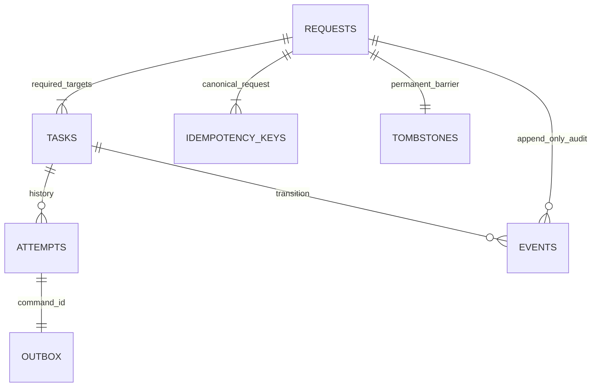
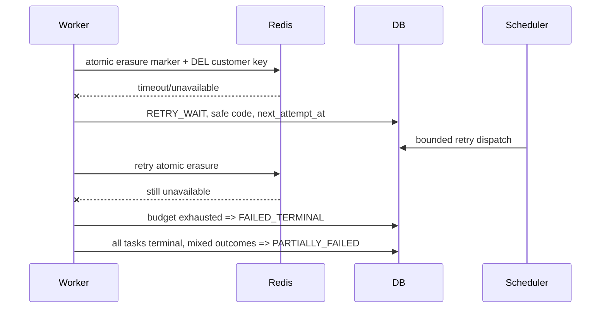
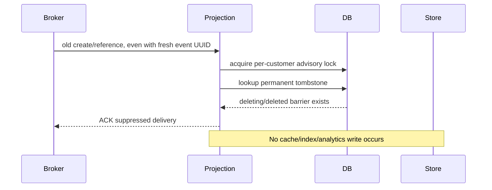

# Phase 2 — Durable deletion orchestration

## Meaning and scope
`COMPLETED_REPORTED` means every required configured target has durably reported successful execution. It **does not mean independently verified absence**. Status responses always contain `independent_verification:false`. Phase 3 will use separate adapters, scopes and observations to evaluate residuals; no verification algorithm is shipped here.

The target registry is the explicit versioned `TARGETS` tuple in `deletion_models.py` and a matching SQL CHECK constraint. All six targets are required. Dynamic target configuration is deliberately unavailable: adding a target requires code, migration, connector and tests. A request is accepted only for an existing synthetic profile, or returned as the canonical existing request for that UUID. Validation and durable request/task/tombstone creation occur in one transaction, before asynchronous dispatch.

## Components and data model
- Dedicated deletion API: port 8005, FastAPI/OpenAPI, `/v1/deletions`.
- SQL scheduler: polls durable state, emits attempt-specific commands into the existing transactional outbox, recovers expired dispatch/running leases.
- Deletion consumer: dedicated durable RabbitMQ queue, explicit ACK after recorded outcome; invalid envelopes go to `deletion.dead`.
- Fixed connectors operate actual PostgreSQL, Redis and OpenSearch resources. No caller-supplied SQL/table/index/key names.
- `002_deletion.sql`: new deletion schema, request/idempotency/tombstone/task/attempt/event tables, constraints, indexes and transition/audit guards; orders.customer_id becomes nullable; outbox gains cancellation metadata for expired unpublished commands.


Outbox link is logical; source-event rows may be removed by deletion. Tasks have an active-attempt FK; attempts have unique task/attempt numbers. Events use request/task FKs, including a composite FK preventing cross-request task attribution. Audit UPDATE/DELETE and tombstone DELETE/reversal are rejected by PostgreSQL triggers. The database owner remains trusted and could disable triggers; this is not a tamper-proof ledger.

Request UUID, customer UUID and correlation UUID are pseudonymous operational identifiers. Tombstones and audit metadata are retained indefinitely in the synthetic lab to prevent resurrection and retain reproducible history. No profile names, emails, raw idempotency keys, credentials or arbitrary exception strings are stored in orchestration audit. Idempotency keys are SHA-256 hashed with the demo operator scope. These identifiers are still linkable metadata, not a claim of legal anonymization.

## Request state machine
| From | Permitted destination | Condition |
|---|---|---|
| REQUESTED | IN_PROGRESS | Scheduler begins processing the durable inventory |
| IN_PROGRESS | RETRYING | Retry wait exists |
| IN_PROGRESS / RETRYING | COMPLETED_REPORTED | Exactly six required tasks are SUCCEEDED_REPORTED |
| IN_PROGRESS / RETRYING | PARTIALLY_FAILED | All tasks terminal, at least one success and one failure |
| IN_PROGRESS / RETRYING | FAILED | All tasks terminal and none succeeded |
| PARTIALLY_FAILED / FAILED | RETRYING | Authorized eligible manual retry within budget |
| COMPLETED_REPORTED | None | Final orchestration report |

Same-state updates are permitted and do not create spurious transition events. Validation precedes request persistence, so no externally visible VALIDATING state is necessary. Cancellation is intentionally absent: a committed tombstone and destructive side effects are not safely reversible. SQL and Python enforce allowed transitions. SQL also rejects premature completion when required tasks are absent or not successful.

## Task state machine
| From | Permitted destination | Condition |
|---|---|---|
| PENDING | DISPATCHED | Prerequisites succeeded; attempt + command committed atomically |
| PENDING / RETRY_WAIT | FAILED_TERMINAL | Required prerequisite failed |
| DISPATCHED | RUNNING | Matching current attempt claimed and committed |
| DISPATCHED / RUNNING | RETRY_WAIT | Retryable failure or expired lease, budget remains |
| DISPATCHED / RUNNING | FAILED_TERMINAL | Exhaustion or permanent failure |
| RUNNING | SUCCEEDED_REPORTED | Connector operation and outcome transaction committed |
| RETRY_WAIT | DISPATCHED | Durable next-attempt timestamp reached |
| FAILED_TERMINAL | PENDING | Explicit manual recovery; no successful target repeats |
| SUCCEEDED_REPORTED | None | Idempotent duplicates do no additional work |

Customer physical removal depends on successful order de-identification and source event-history cleanup. Other tasks may succeed even when another target fails. Dependency failure produces an explicit failed customer task rather than hanging forever. Manual retry resets only failed tasks; all attempt and audit history is retained.

## Supported deletion semantics
| Target | Actual operation and scope |
|---|---|
| customer | Delete the profile row by UUID after prerequisites; no cascade |
| orders | Set direct customer_id to NULL; retain order UUID, amount, currency, timestamp |
| cache | Atomic Lua: persist `deletion:customer:{UUID}` marker and DEL `customer:{UUID}`; marker has no profile fields |
| search | Replace `customers/_doc/{UUID}` with only `{"erased":true}`, external version 2, refresh=wait_for; this removes profile fields and retains a durable anti-resurrection sentinel |
| analytics | Delete all customer-linked event rows, including profile and order payloads |
| event_history | Delete customer/order outbox payload rows and projection processing receipts for this UUID |

Only fixed supported namespaces are covered. De-identified orders keep random order IDs, not customer IDs. Other applications, arbitrary cache key patterns, indices, snapshots, replicas, backups, external exports, physical storage recovery and historical logs are outside this inventory. Failures are never translated into success: Redis/HTTP errors become safe retryable codes; SQL errors roll back to a savepoint before recording failure; unsupported targets are permanent failures.

## Retry, leases and acknowledgment
Each task has three automatic attempts per cycle. Backoff is exponential (`base * 2^(attempt-1)`, capped at 30 seconds), persisted in SQL. Default base is two seconds; Compose uses one second for student tests. A dispatch lease is 30 seconds. Each dispatch has a new stable attempt/event UUID and a persistent mandatory RabbitMQ publication with publisher confirmation.

A connector first commits RUNNING, then performs its operation under the subject barrier and records the outcome before ACK. Unexpected DB/commit failure closes the channel without ACK. A crash after external deletion but before recording can repeat the idempotent SQL deletion, Redis Lua scrub, or versioned OpenSearch replacement. RUNNING or DISPATCHED attempts that expire are durably failed/rescheduled by the scheduler; obsolete unpublished commands are cancelled, and obsolete or duplicate delivered commands cannot execute a newer generation. An ACK of a duplicate/stale message releases only that delivery; durable task/lease state continues to own recovery. No exactly-once claim is made.

Manual retry is allowed for Redis/search/database unavailability, lease expiry and dependency failures, with at most three manual rounds. Repeated calls while work is active return its current state without resetting attempts or budgets. Successful requests reject retry. Permanent unsupported targets reject retry. Recovery does not depend on broker retry headers or in-memory timers. Heartbeats prove process/event-loop liveness, not progress; inspect SQL-backed attempts, timelines and metrics.

The single deletion queue serializes connector work within one process; slow targets can delay later tasks. Leases count queue delay too, so under sustained backlog tasks may exhaust without execution and require recovery. This is observable rather than silently reporting success. Scaling consumers and fair per-target dispatch are future capacity work; lock/attempt checks support safe duplicate consumers. Broker/storage catastrophic loss and exhaustive partition schedules remain untested.

## Resurrection prevention and write consistency
A deletion tombstone is committed at admission and never removed. New order writes acquire the same PostgreSQL customer advisory lock as projection writes and deletion operations, then reject tombstoned UUIDs with 409. Profile creation still uses a fresh UUID; UUID reuse is not supported. Existing profiles are immutable in the Phase 1 API: PATCH/PUT and customer.updated events are unsupported and fail closed. This phase does not invent an unimplemented update/version protocol.

Projection consumers acquire the per-customer lock and check tombstones before every Redis/search/analytics write, including legacy v1 events with fresh event UUIDs. The lock is held through the external operation and receipt commit. If a write won the lock first, admission waits for its commit and the subsequent deletion removes it. If deletion won first, later writes are skipped regardless of event order, identifier duplication or occurred_at. Tombstones override every event; they do not rely on queue ordering or clocks. Unknown revisions/types are rejected to DLQ. SQL unavailability prevents projection writes, rather than falling back to an unsafe local allow.

All supported writers and workers must use this boundary. Direct administrative DB/store writes or old deployed consumers that ignore it are outside the guarantee. This shared PostgreSQL coordination is a deliberate Phase 1 infrastructure tradeoff, not a general independent-database distributed-lock solution. External timeouts are ambiguous, so the SQL lock alone is insufficient. Redis uses an atomic Lua check-and-write and a permanent store-side deletion marker. Search creation uses external version 1; deletion removes all profile fields by replacing the document with a persistent external-version-2 `{"erased":true}` sentinel. A delayed version-1 write receives 409 even if it arrives after deletion or process restart. Physical OpenSearch DELETE tombstones can expire, so they are deliberately not the lasting fence. Repeated deletion at version 2 is idempotent. The read-only inspection endpoint reports profile-fields absent while explicitly exposing `document_present:true`, `erasure_marker:true`, and `scope:profile_fields`; it does not hide the retained sentinel. Direct raw document GET can inspect it. Redis markers and OpenSearch sentinel document IDs retain pseudonymous UUID linkage by explicit policy. They are not profile copies or a claim that every byte/identifier was erased. Phase 3 must independently inspect actual store state and coverage.

## Event contracts and transport retention
`DeletionCommand` v1 contains event/attempt UUID, request UUID, task UUID, customer UUID, correlation UUID and fixed target name. It contains no profile data. `EventReference` v1 carries source event/customer/correlation UUIDs and source_type; projection consumers resolve the source payload in SQL and recheck the tombstone before applying it. The original `Event` v1 schema is preserved for source outbox data and legacy delivery compatibility. JSON Schemas are checked into docs; runtime Pydantic models reject extra fields and unsupported versions.

Unpublished creation events for tombstoned subjects are excluded from publication; the event-history connector removes their raw outbox payloads. Published Phase 2 references and deletion commands can remain in RabbitMQ/DLQs without carrying names/emails. They still carry pseudonymous IDs. Legacy Phase 1 messages and deliberately injected raw-event test fixtures may contain profile payloads until acknowledged or manually remediated. Selective physical deletion from arbitrary broker queues, dead letters, disk logs and backups is **not a supported connector**. Before upgrading an existing Phase 1 instance, drain old queues with its consumers and resolve legacy dead letters without purging unrelated messages. Do not claim orchestration completion proves absence in legacy transport copies. New installations emit only identifier references.

## Security and APIs
The destructive API is disabled unless APP_ENV=demo, DELETION_TOKEN has at least 24 characters, and X-Deletion-Token matches in constant time. No default destructive credential exists. `configure_demo.py` generates independent random credentials once with mode 0600 and refuses overwrite. Existing installation credentials must be preserved on upgrade. Inspection uses a separate token; an inspection token does not authorize deletion. APIs bind loopback and store ports are unpublished. No public deployment is performed.

One shared demo-operator role is supported, not multi-user identity, RBAC or tenant separation. Admission of new deletion requests is limited to 30 per minute in SQL, serialized under an admission lock. Replays do not create new requests or tasks; aliases point to one request per customer. Key reuse for another customer is 409. The retry budget prevents repeated manual requests from causing unlimited automatic work. GET/list/events require authorization too. No TLS or hardened service-to-service auth is added; do not expose this demo as production.

| Method / path (port 8005) | Behavior |
|---|---|
| POST /v1/deletions | customer_id + idempotency_key, returns 202 |
| GET /v1/deletions/{id} | Typed request, tasks, attempt history, durations/codes |
| GET /v1/deletions?state=...&limit=20&offset=0 | Bounded pagination/filter |
| GET /v1/deletions/{id}/events?after=0&limit=100 | Chronological append-only audit pages |
| POST /v1/deletions/{id}/retry | Authorized eligible recovery, 202 or 409 |
| GET /v1/deletions/metrics | Per-target/state counts, total attempts and retry count |

## Sequences

Successful deletion:
```mermaid
sequenceDiagram
 participant Operator
 participant API
 participant DB
 participant Scheduler
 participant Broker
 participant Worker
 Operator->>API: authenticated POST + idempotency key
 API->>DB: transaction: canonical request + tombstone + six tasks + audit
 API-->>Operator: 202 REQUESTED
 Scheduler->>DB: dispatch attempts + identifier commands in outbox
 DB->>Broker: existing confirmed outbox publisher
 Broker->>Worker: deletion command
 Worker->>DB: commit RUNNING; acquire subject barrier
 Worker->>Worker: actual target delete/de-identify and remote version fences
 Worker->>DB: commit outcome + attempt + audit
 Worker-->>Broker: ACK
 Scheduler->>DB: dispatch customer after prerequisites
 Worker->>DB: all six reported success => COMPLETED_REPORTED
```

Partial failure:


Recovery:
```mermaid
sequenceDiagram
 participant Operator
 participant API
 participant DB
 participant Scheduler
 participant Worker
 Operator->>API: POST request/retry after restoring target
 API->>DB: lock request; check budget; reset failed tasks only
 API-->>Operator: 202 RETRYING
 Scheduler->>DB: new attempt + outbox command
 Scheduler->>Worker: RabbitMQ delivery via publisher
 Worker->>DB: operation result + retained attempt history
 Worker->>DB: all required success => COMPLETED_REPORTED
```

Stale-event rejection:


## Reproducible demonstration
Fresh local setup:
```sh
python3 scripts/configure_demo.py
docker compose up --build -d --wait --wait-timeout 240
python3 -m venv .venv
. .venv/bin/activate
pip install -c requirements.lock -e '.[dev]'
set -a; . ./.env; set +a
python scripts/deletion_demo.py
```
The script creates a synthetic customer, waits for real propagation, submits deletion, prints observed lifecycle plus complete audit history, all target/attempt results and read-only store observations. Fast transient states may be missed by polling but are retained in the timeline.

Manual request (replace UUID and use a fresh stable key):
```sh
curl -sS http://localhost:8005/v1/deletions -H "X-Deletion-Token: $DELETION_TOKEN" \
 -H 'Content-Type: application/json' -d '{"customer_id":"CUSTOMER_UUID","idempotency_key":"demo-request-001"}'
curl -sS http://localhost:8005/v1/deletions/REQUEST_UUID -H "X-Deletion-Token: $DELETION_TOKEN"
curl -sS http://localhost:8005/v1/deletions/REQUEST_UUID/events -H "X-Deletion-Token: $DELETION_TOKEN"
```
To intentionally fail a target, create/propagate a customer first, `docker compose pause redis`, then submit its deletion. Poll until PARTIALLY_FAILED (Redis must remain paused through all three attempts). Restore with `docker compose unpause redis`, then:
```sh
curl -sS -X POST http://localhost:8005/v1/deletions/REQUEST_UUID/retry \
 -H "X-Deletion-Token: $DELETION_TOKEN"
```
Always unpause even if an experiment is interrupted. This exercises the actual Redis operation, not a status-only fault flag. OpenSearch can be paused analogously; HTTP attempts have bounded timeouts.

Full scenarios, including deterministic SIGKILL after RUNNING and SQL barrier acquisition, duplicate broker delivery, outbox recovery, stale raw events and delayed consumers:
```sh
RUN_INTEGRATION=1 pytest tests/test_deletion_integration.py -v
# Only failed-target/retry demonstration:
RUN_INTEGRATION=1 pytest tests/test_deletion_integration.py -k retry_exhaustion -v
# Delayed search/Redis/analytics events arriving after completed deletion:
RUN_INTEGRATION=1 pytest tests/test_deletion_integration.py -k delayed_consumers -v
```
These tests create their own synthetic fixtures and use real Docker commands. Read-only `/v1/inspect/customers/{id}` endpoints (ports 8002–8004), source GET, source SQL and propagation inspection remain available for future independent adapters. SQL inspection of `orders.orders`, `delivery.outbox`, `analytics.events` is possible through the local container; Phase 3 should use separately scoped read credentials rather than trust task receipts.
