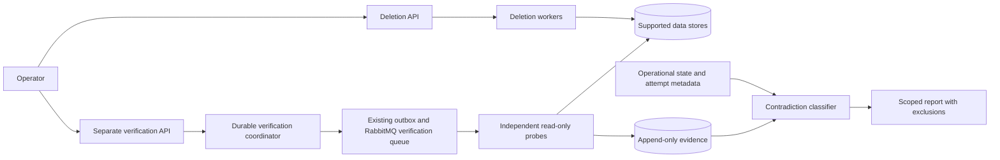
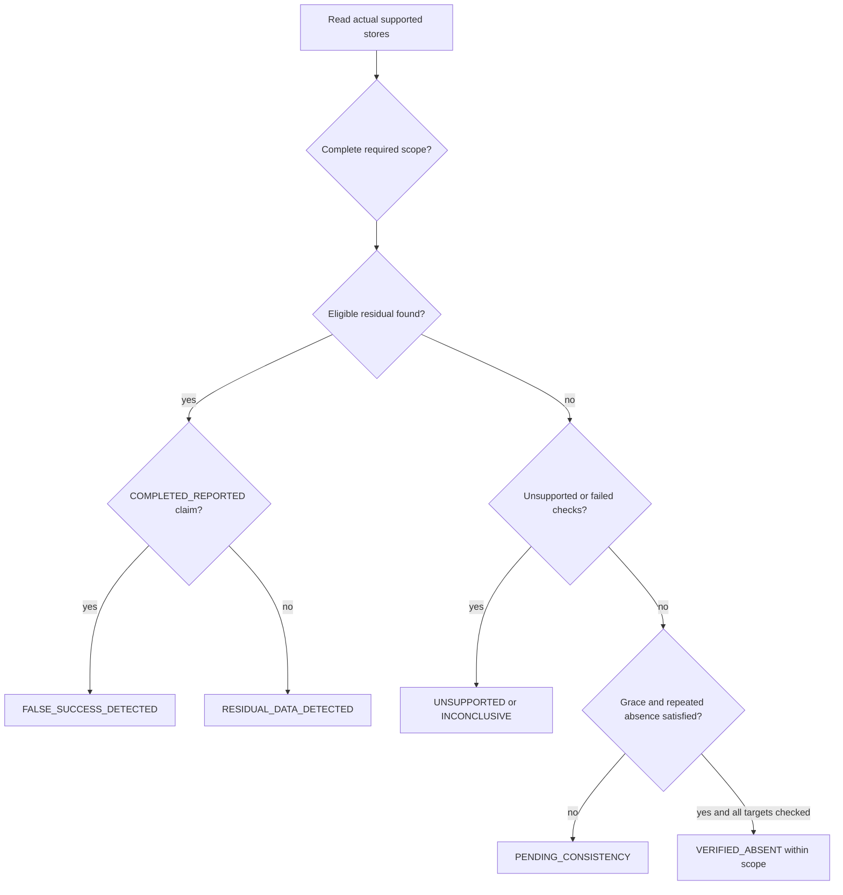
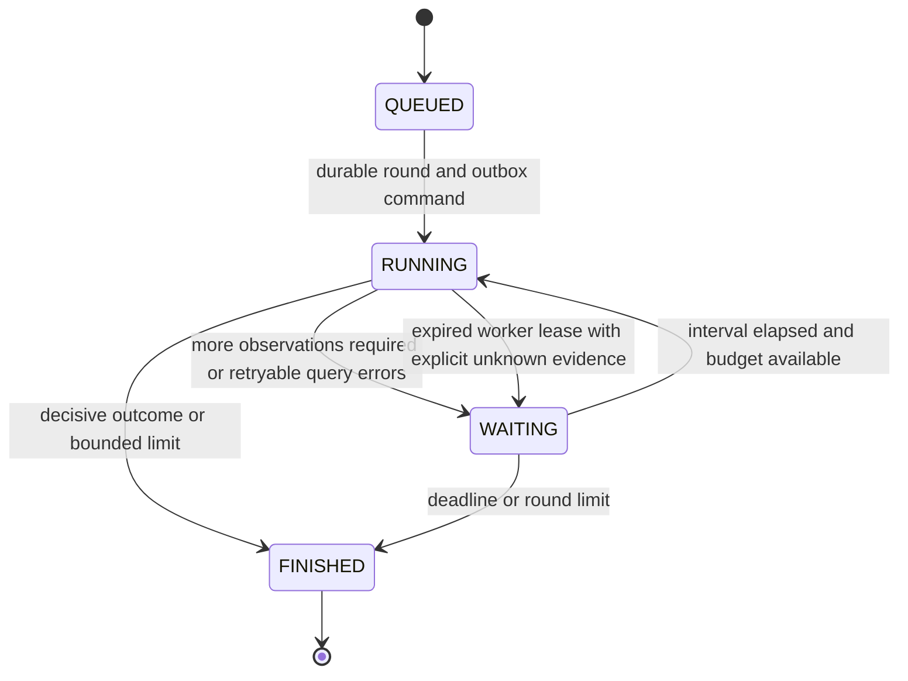
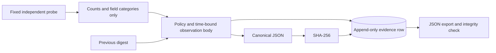

# Phase 3 — Independent logical deletion verification

## Claim and trust boundary
Verification observes actual PostgreSQL, Redis and OpenSearch state through fixed read-only adapters. It does not invoke deletion connectors, call operational inspection endpoints, erase residuals, trust worker acknowledgments as absence evidence, or reuse an earlier report as a fresh observation. Decisions are deterministic Python rules, not LLM judgments.

`VERIFIED_ABSENT` means no policy-prohibited matching data was found in every required successfully checked scope, after the declared consistency conditions and repeated observations. It does not mean irreversible erasure, physical sanitization, cryptographic erasure, backup deletion, universal anonymity or legal compliance. Later runs can detect reappearance. The stores are not queried in one atomic distributed snapshot.


The operational state defines the settling cutoff and supplies the claim being compared. It never substitutes for a data probe. Partial operational failure plus residue is a residual finding, not a false claim of total success. Positive observations may establish residue even when another target is unknown; unknown targets remain explicit in the same report.

## Scope and retention
The versioned machine-readable specification is [policies/scope-v1.json](../policies/scope-v1.json). Its complete JSON snapshot, digest, six required targets and consistency parameters are captured in every run. Users cannot submit arbitrary queries or choose a convenient target subset. The union with actual deletion task inventory is captured, so an unknown target cannot silently disappear.

| Phase 2 target | Independent read strategy | Permitted retention and limits |
|---|---|---|
| customer | Primary-key SQL COUNT on customer.customers | Profile row prohibited; deletion tombstones in their own schema are permitted |
| orders | SQL query by direct customer_id OR captured order UUID, then complete row JSON classification | Only id, null customer_id, amount_cents, currency and created_at permitted; extra non-null fields fail policy |
| cache | Bounded SCAN of customer:{uuid}* and deletion:customer:{uuid}*, TYPE and GET | Exact deletion marker value `1` is permitted; profile/derived values are residual; unsupported types/scan truncation are inconclusive |
| search | Real-time document GET plus independent _search by document ID and id/customer_id/data.id/data.customer_id fields | Only exact erased=true marker at subject ID and version >=2 is permitted; field-linked derived documents are inspected too |
| analytics | SQL direct customer UUID and exact recursive JSON UUID match | Matching linked records prohibited; this repository has no separately retained aggregate table |
| event_history | SQL source/control outbox classification and processing receipt inspection | Source payloads prohibited; typed identifier-only commands and fixed receipt metadata permitted, not arbitrary strings in metadata-shaped keys |

Minimal erasure markers and audit/manifest UUID linkage remain pseudonymous and linkable. They are **not declared anonymous**. Transaction facts are permitted by this synthetic scope policy, not inferred safe merely because customer_id was removed. Evidence contains counts/classifications and operational UUIDs, not raw names, emails, key values, document contents, arbitrary exceptions or hashes of personal values.

### Order inventory correction
Phase 2 removed order/customer associations without retaining order IDs for later field inspection. New deletion admission captures a minimal immutable `deletion.order_manifest` and `deletion.scope_captures` while holding the same subject lock that prevents new order writes. The verifier independently inspects the actual identified order rows, including unexpected fields. No raw profile data is added to this manifest.

Historical Phase 2 requests without a scope capture cannot retrospectively establish complete order coverage; their order result is INCONCLUSIVE unless positive residue is found. There is no invented backfill or assertion of complete anonymization. The manifest itself remains explicitly permitted pseudonymous verification inventory; an adversarial or incorrect inventory is a coverage limitation.

Excluded locations include legacy RabbitMQ payload/dead-letter bytes, arbitrary keys/indices/identifier aliases outside the declared paths, snapshots, external exports, unconfigured replicas, backups and physical media. Configuration correctness, supported writers and database/store operators are trusted. A value hidden under an unknown identifier cannot be universally discovered by this system.

## Outcomes and aggregation
Per-target outcomes:
- VERIFIED_ABSENT: successful complete scope, eligible settling window, two spaced negative observations under the same consistency anchor.
- RESIDUAL_DATA_DETECTED: eligible matching prohibited data observed.
- PENDING_CONSISTENCY: active orchestration, grace window not elapsed, or insufficient spaced negative samples.
- INCONCLUSIVE: query/permission/unavailability error, malformed response, truncated scope, missing historical manifest, deadline exhaustion or insufficient evidence.
- UNSUPPORTED: required adapter missing.

Within an unsettled window, raw positive/negative observations are retained in evidence but conclusions remain pending. Errors and unsupported capabilities do not become pending success. Request aggregation precedence is:
1. Any required eligible residual => FALSE_SUCCESS_DETECTED if the sampled operational claim is COMPLETED_REPORTED, otherwise RESIDUAL_DATA_DETECTED.
2. Otherwise any required unsupported => UNSUPPORTED.
3. Otherwise any inconclusive => INCONCLUSIVE.
4. Otherwise any pending => PENDING_CONSISTENCY.
5. Only all required targets VERIFIED_ABSENT => VERIFIED_ABSENT.

An empty inventory is inconclusive. A missing result is unsupported. Every target remains in the report even when another target establishes a positive contradiction. Findings identify target, data category, observation timestamp, violated rule, corresponding task/current-attempt metadata and evidence UUID/digest. This is a time-specific contradiction, not evidence that the original worker intentionally lied. Controlled reappearance after completion is distinguishable through timestamps and historical runs.



## Durable coordinator and consistency policy
The verification API and scheduler/worker are separate services. Migration `003_verification.sql` creates immutable scope inventory plus verification runs, targets, evidence and timeline tables, indexes, foreign keys, state/append-only guards and least-privilege role/RLS provisioning boundaries.

Default policy: three-second grace after both run creation and the latest terminal orchestration timestamp; two eligible negative observations separated by two-second scheduled rounds; 90-second run deadline; at most eight rounds; at most three consecutive probe-error rounds before an inconclusive final result. A changed orchestration consistency anchor resets each target's negative streak. Each probe records its own observation time; a later slow probe cannot retroactively make an earlier observation eligible. An absence collected after the deadline is inconclusive. A bounded in-flight operation may finish after the scheduling deadline; it cannot create a late successful absence claim.

Each round is dispatched transactionally through the existing outbox as a typed identifier-only verification.command. The existing confirmed persistent publisher and dedicated durable RabbitMQ queue/manual ACK are reused. A session advisory lock serializes duplicate execution, and active message/round checks fence stale deliveries. All round evidence, target results and aggregation commit together before ACK. Worker loss releases the lock; broker redelivery can safely repeat reads, and a 30-second lease provides durable recovery even if a delivery disappears. Lease recovery records explicit no-observation/inconclusive evidence, never fabricated negatives. Finished runs and targets are immutable through normal SQL paths; reruns create new histories.



The two-sample policy observes limited stability; it does not prove no future event can recreate data. SQL and remote erasure fences remain useful independent consistency context, but their existence and worker progress are not absence proof. Delayed consumers and inaccessible services remain observable as pending/inconclusive states. Query limits are 1,000 SQL rows/Redis keys and 200 search hits; truncation cannot yield verified absence. SQL read statements have a three-second timeout, Redis commands two seconds plus a bounded scan window, and OpenSearch requests three seconds each. One verification worker serializes rounds; capacity is bounded to ten active and thirty new runs/minute. Scaling and adversarial schedules belong to Phase 4.

## Evidence and exports
Every observation includes run/deletion/target IDs, correlation UUID, adapter/version, policy version/digest, fixed query category, raw outcome and policy conclusion, observed time, consistency metadata, sanitized summary, scope completeness, safe error code, independent query count, duration and operational comparison metadata. Canonical JSON uses sorted keys, stable compact separators, UTC timestamps and no non-finite numbers. Each record hashes its canonical body, including sequence and previous digest. SQL prevents ordinary evidence UPDATE/DELETE; exports validate chain continuity and body/header identity.


This is not a signature, trusted timestamp authority or protection against a privileged administrator rewriting the database and its hashes. An independently saved export/head digest can reveal later mismatches, but database-local hashes alone cannot defeat an administrator. Evidence is historical and not a fresh query. JSON report exports include all evidence, findings, incomplete/excluded scopes, policy and timeline.

## Security boundaries
- Independent VERIFICATION_TOKEN is required on all verification APIs, distinct from deletion/inspection credentials; APP_ENV must be demo. Tokens have no hardcoded enabled default.
- verification_probe has SELECT privileges only on supported source tables and scope metadata; read connections additionally enforce default_transaction_read_only and short statement/lock timeouts.
- verification_coordinator can mutate only its control schema and insert verification.command outbox rows under RLS. It cannot read/write profile tables or publish deletion.command rows through SQL.
- Redis uses a separately provisioned ACL user limited to SCAN/GET/TYPE/EXISTS/PING and supported namespaces; SET/DEL/EVAL are denied. The local Redis ACL is provisioned at stack startup. After an isolated Redis container restart, rerun `docker compose run --rm provision-verification` before verification if the runtime ACL was lost; failures remain inconclusive rather than falling back to admin credentials.
- OpenSearch's Phase 1 security plugin remains disabled on the private Docker network. The adapter uses only fixed GET and POST _search operations. Server-enforced OpenSearch read-only credentials are not available in this lab configuration; a compromised verifier container remains outside the stronger least-privilege guarantee. Transport broker trust is also shared. Harden these in Phase 6.
- No arbitrary user SQL, key patterns, indices, query bodies or adapter exclusions are accepted. API endpoints bind loopback; no public deployment is performed.
- Faults are administered by explicitly opted-in synthetic test/demo drivers, not public fault APIs. The optional missing-adapter switch is honored only by an ephemeral worker with ENABLE_TEST_FAULTS=1; normal Compose services do not enable it. Do not deploy fault-enabled workers.

## API (port 8006)
| Method/path | Behavior |
|---|---|
| POST /v1/deletions/{request_id}/verifications | 202 durable run; idempotency_key and fixed policy_version; new key reruns |
| GET /v1/deletions/{request_id}/verifications | Bounded chronological history, limit/offset |
| GET /v1/verifications/{id} | Typed state, policy snapshot, target outcomes and limits |
| GET /v1/verifications/{id}/evidence | Sanitized pages, sequence after/limit |
| GET /v1/verifications/{id}/report | Complete typed JSON evidence report with integrity result and exclusions |
| GET /v1/verifications/{id}/timeline | Bounded event history |

All require X-Verification-Token. Creation is rate/capacity limited. Same key and deletion ID return the same durable run; a new key creates a new run even after an earlier verified result. Missing deletion/run IDs return 404, unsupported policy/input 422, disabled/wrong authorization 403, and capacity limits 429.

## Demo, faults and re-verification
Fresh setup:
```sh
python3 scripts/configure_demo.py
docker compose up --build -d --wait --wait-timeout 240
python3 -m venv .venv
. .venv/bin/activate
pip install -c requirements.lock -e '.[dev]'
set -a; . ./.env; set +a
python scripts/verification_demo.py
# Explicit local synthetic residue, observed contradiction, separate cleanup and successful rerun:
ERASEPROOF_TEST_FAULTS=1 python scripts/verification_demo.py --inject-synthetic-fault
```
The executable driver creates/propagates a fresh customer, deletes it through the real orchestrator, queries the real verifier, prints individual outcomes and saves sanitized JSON to work/verification-demo-report.json. The optional fault adds a synthetic derived Redis key through an admin-only local Docker command, verifies its detection, cleans that exact key in a finally block, and runs new verification. Collection itself never repairs data. CI executes this driver as well as the regression suite.

```mermaid
sequenceDiagram
 participant Demo
 participant Deletion
 participant Verifier
 participant Stores
 Demo->>Deletion: synthetic creation and deletion
 Deletion-->>Demo: COMPLETED_REPORTED
 Demo->>Verifier: first run
 Verifier->>Stores: direct read-only probes
 Verifier-->>Demo: VERIFIED_ABSENT within scope
 Demo->>Stores: explicitly gated synthetic residual fault
 Demo->>Verifier: new run and new idempotency key
 Verifier->>Stores: fresh probes
 Verifier-->>Demo: FALSE_SUCCESS_DETECTED plus evidence
 Demo->>Stores: separate authorized fixture cleanup
 Demo->>Verifier: subsequent run
 Verifier-->>Demo: new evidence-backed outcome; old reports preserved
```

Manual API examples after obtaining a deletion request UUID:
```sh
curl -sS -X POST http://localhost:8006/v1/deletions/REQUEST_UUID/verifications \
 -H "X-Verification-Token: $VERIFICATION_TOKEN" -H 'Content-Type: application/json' \
 -d '{"idempotency_key":"verification-demo-001","policy_version":"scope-v1"}'
curl -sS http://localhost:8006/v1/verifications/RUN_UUID -H "X-Verification-Token: $VERIFICATION_TOKEN"
curl -sS http://localhost:8006/v1/verifications/RUN_UUID/report \
 -H "X-Verification-Token: $VERIFICATION_TOKEN" > work/exported-report.json
```
Existing installations must preserve old credentials and add fresh random VERIFICATION_TOKEN, VERIFIER_DB_PASSWORD, VERIFIER_CONTROL_PASSWORD and VERIFIER_REDIS_PASSWORD (at least 24 URL-safe characters each). Stop old services before migration/upgrading; preserve volumes. The helper intentionally refuses to overwrite .env. Historical requests lacking an order manifest remain explicitly incomplete.

## Tests and initial evaluation
```sh
# Unit/control-flow checks only:
make lint
make test
# Entire real Phase 1–3 suite, explicitly allowing synthetic administrative fault fixtures:
RUN_INTEGRATION=1 ERASEPROOF_TEST_FAULTS=1 pytest -m integration -v
# Reproduce the measured verification scenario set:
ERASEPROOF_TEST_FAULTS=1 python scripts/evaluate_phase3.py
```
Real tests cover normal deletion and safe markers, searchable alternate-document residue, derived Redis residue, analytics residue, order personal-field defects, source/history residue, probe outages, eventual consistency, later reappearance, missing adapter, duplicate/concurrent execution and SIGKILL/restart. Existing Phase 1/2 tests remain enabled. Permission tests actually attempt forbidden writes with probe/coordinator credentials; evidence immutability and canonical export validation are checked. Fault cleanup is separate and scoped to synthetic fixtures.

The evaluation writes work/phase3-evaluation.json plus sanitized per-case reports. Counts, raw scenario outcomes, known fixture ground truth, time to final result, queried targets, attempted data-plane query commands and adapter durations are measured, not fabricated. The internal baseline trusts COMPLETED_REPORTED and issues zero data probes; it is not a commercial competitor. Measurements exclude transport/control-plane/evidence queries, connections, server CPU/I/O and network bytes. Cases are small controlled demonstrations, not population accuracy estimates or a comprehensive adversarial benchmark. CI uploads the actual artifacts; the completion report records observed results only after CI runs.

Phase 4 must expand controlled schedules, ambiguous failures, coverage inventories, workload scaling, reproducible sampling/ground truth, confidence intervals, out-of-scope copies and adversarial tests. No Phase 3 result proves data cannot ever reappear.
