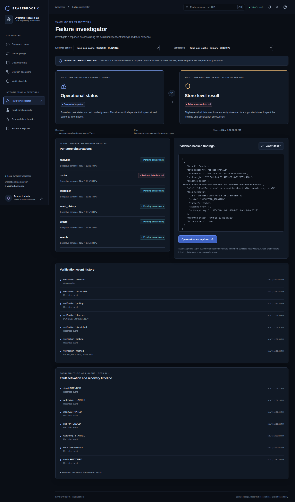
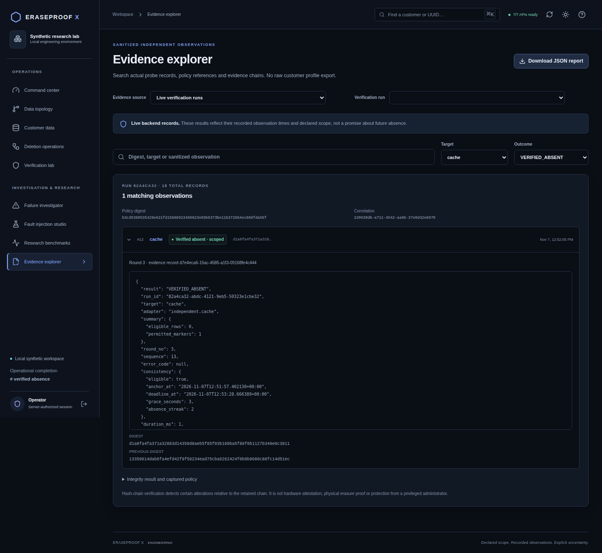
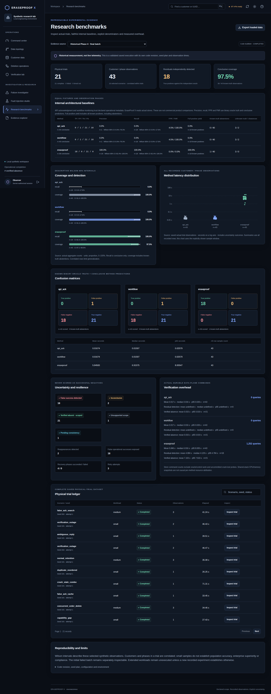

# Phase 5 — actual browser captures

These unaltered Chromium images come from CI run [42372698385](https://github.com/bhuvzzs24-spec/Eraseproof-x/actions/runs/42372698385), runtime revision `4b7aa3c524e5652d9d476a1751f2a38f7f3f7cf7`. Full-stack images use the actual Docker stores; the historical research image uses the validated saved Phase 4 dataset.

## Live false-success investigation

The cache reported success while independent verification found residue. Other targets can remain pending when the contradictory evidence ends the run. Job-source labels can lag by one five-second poll.

## Live scoped-absence evidence

Actual sanitized adapter observation, timing, policy and digest. A linked report can load before the recent-run picker finishes loading; run pickers list at most 100 recent records.

## Historical research workspace

Actual saved Phase 4 measurements; explicitly labeled historical, not live telemetry.

All nine workspaces were captured at 1440×1000 and 1024×768, with an additional 768×1024 light-theme view. CI browser artifacts retain the full image collection and JSON/HTML test results. See [validation](phase5-validation.md) for actual counts, failures, limitations and deployment boundaries.
