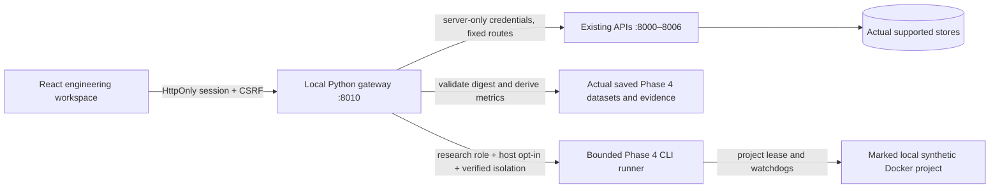

# Phase 5 — engineering workspace

EraseProof X now has nine integrated workspaces: Command center, Data topology, Customer data explorer, Deletion operations, Verification lab, Failure investigator, Fault injection studio, Research benchmarks and Evidence explorer. This is a local application; it has not been publicly deployed. No cloud resources are purchased or provisioned. Browser traces are disabled to avoid retaining ephemeral login/session credentials; screenshots and structured test results provide review evidence.

## Architecture

The existing Python services remain the source of truth. React 19 + TypeScript + Vite produces a static SPA; TanStack Query manages cached reads, cancellation, bounded polling and invalidation. A Python FastAPI gateway serves the production build and same-origin `/api` endpoints. This adapts to the existing Python/Docker research runner without introducing an additional Node production server or browser-visible backend credentials. Node is a build/development dependency. Charts are lazy-loaded SVG with tabular alternatives; topology uses accessible native buttons over a declared architecture graph.



The gateway's source map is explicit. Environment-controlled backend origins are `DASHBOARD_CUSTOMER_ORIGIN`, `DASHBOARD_ORDER_ORIGIN`, `DASHBOARD_CACHE_ORIGIN`, `DASHBOARD_SEARCH_ORIGIN`, `DASHBOARD_ANALYTICS_ORIGIN`, `DASHBOARD_DELETION_ORIGIN` and `DASHBOARD_VERIFICATION_ORIGIN`. Development defaults are loopback ports 8000 through 8006; deployable origin configuration is server-side. There are no `VITE_*` secrets. Development Vite proxies `/api` to `DASHBOARD_GATEWAY_ORIGIN` (default http://127.0.0.1:8010). Production serves assets and API from the same origin. Cross-origin API access is not enabled.

The customer service adds bounded, inspection-token-protected read models at `/v1/dashboard/snapshot`, `/customers`, `/deletions` and `/verifications`. They query actual SQL records, include explicit totals where appropriate and retain original API/state-machine behavior. Overview counts are live database aggregates; health is real API readiness. Broker/worker components without exposed probes are explicitly architecture metadata, not fabricated live status.

## Design system and information architecture

Deep neutral surfaces, blue controls, cyan pending states, amber uncertainty and restrained green scoped absence distinguish claims from observations. Shared CSS tokens support dark and light themes. Reusable panels, badges, notices, forms, tables, confirmation dialogs and timelines keep all workspaces consistent. Status text accompanies color. System fonts avoid external font traffic. Responsive tables scroll within labeled regions rather than overflowing the page. Reduced-motion preferences stop decorative transitions/spinners; keyboard focus is visible, forms have labels and the main workspace has a skip link.

The signature investigation view places the actual operational claim beside the independent result, then links per-store outcomes, sanitized observations, timestamps, policy versions, digests, retries and real fault timelines. It does not label reported completion as verified absence. Policy-boundary text is labeled as policy, not a successful verdict when a run found residue.

Research charts always label their source, sample size and units. Historical datasets are explicitly labeled saved executions, separate from live database metrics. The final and initial failed Phase 4 batches are loaded and digest-validated; metrics are recomputed from retained trials, not constants in frontend code. Baselines remain internal architectural monitors. Unknown outcomes and abstentions remain visible. Live experiment trial pages and their latency sample window are labeled; aggregate metrics can cover more rows than the current page.

## Roles and security boundaries

- **Read-only observer:** inspect authorized operational records, historical/live research data and sanitized evidence; download reports. No data mutations, retries, verification launches or fault execution.
- **Operator:** observer capabilities plus synthetic customer/order creation, deletion, bounded retry and independent verification.
- **Research administrator:** operator capabilities plus explicitly enabled isolated scenario execution.

The gateway enforces roles server-side for every mutation; disabled buttons are only a usability aid. Opaque 256-bit sessions use HttpOnly, SameSite=Strict cookies, a server-side SQLite digest/role/expiry record, eight-hour expiry and revocation on logout. Role passwords remain in host environment/configuration and are compared through scrypt-derived values; privileged store/service tokens never enter the bundle, JSON session response or localStorage. Only the color theme is stored locally. Login is rate limited. Mutations require exact configured Origin and a session-bound CSRF header. Invalid upstream statuses, unreadable responses, unavailable services and timeouts remain errors, not successful jobs.

`compose.dashboard.yaml` is required for dashboard use. It sets a separate `OPERATOR_TOKEN` on customer/order write APIs so direct requests cannot bypass the gateway's role model. Gateway and research-runner requests supply that credential server-side. Ordinary Compose without this overlay retains the original trusted-local synthetic-write mode for backward-compatible Phase 1–4 scripts/tests; **that mode is not a public authorization boundary**. Do not expose it publicly. Deletion, verification and inspection retain their separate existing credentials.

Research controls default off. Enabling them requires the research role, `DASHBOARD_ENABLE_RESEARCH=1`, `ERASEPROOF_RESEARCH_FAULTS=1`, APP_ENV=demo, confirmation in the UI and all real Phase 4 local-engine/project/label/loopback checks. The browser may select only a registered scenario and bounded integer seed. The server fixes one small-tier trial, fixed CLI arguments, a 180-second experiment budget and a bounded supervisor. It accepts no shell commands, arbitrary paths, infrastructure targets or custom executable code. Existing database project leases and fault watchdogs remain effective. Raw runner logs and credentials are not exposed by static file serving or APIs.

The research job automatically creates fixtures, introduces the real fault, performs deletion and independent verification, saves results and cleans its fixtures. The UI advertises the combined action accurately. After cleanup, a fresh live verification can legitimately differ from the saved pre-cleanup report. Scenario expectations are protocol metadata; they are not supplied to the verifier as answers. Pending, failed, interrupted and partial executions remain visible.

## Local setup — exact commands

Prerequisites: Python 3.12+, Node 24+, Docker Engine/Compose with the Phase 1–4 infrastructure requirements. Keep this on a trusted local host. A new research project uses its own volumes; an existing ordinary stack must release ports 8000–8006 before starting it.

```sh
python3 -m venv .venv
. .venv/bin/activate
pip install -c requirements.lock -c requirements-benchmark.lock -e '.[dev,benchmark]'
# New installation only: these helpers preserve/refuse to overwrite existing files.
python scripts/configure_demo.py
python scripts/configure_dashboard.py
set -a
. ./.env
. ./.dashboard.env
set +a
export COMPOSE_PROJECT_NAME=eraseproof-research-dashboard
export DASHBOARD_RESEARCH_PROJECT="$COMPOSE_PROJECT_NAME"
export COMPOSE_FILE=compose.yaml:compose.research.yaml:compose.dashboard.yaml
docker compose up --build -d --wait --wait-timeout 240
npm --prefix frontend ci
npm --prefix frontend run build
DASHBOARD_ORIGIN=http://127.0.0.1:8010 python scripts/start_dashboard.py
```

Open http://127.0.0.1:8010. Read the corresponding role password from `.dashboard.env` on the trusted host and enter it in the sign-in form. That file is mode 0600 and ignored by Git. Do not paste its contents into public logs. Existing dashboard credentials are not silently replaced. For older credential files created before the operator token existed, add a fresh random `OPERATOR_TOKEN` and reload the overlay; do not reuse the role password.

Development with hot updates uses two terminals:

```sh
# Terminal A, with the same virtualenv and server-only environment loaded:
DASHBOARD_ORIGIN=http://127.0.0.1:3000 python scripts/start_dashboard.py
# Terminal B:
npm --prefix frontend run dev
```

Open http://127.0.0.1:3000. Vite proxies the same-origin API. Port 8010 remains the local gateway. The configured Origin must match the browser URL exactly; localhost and 127.0.0.1 are different origins.

To explicitly enable authorized real research execution on the marked stack:

```sh
DASHBOARD_ORIGIN=http://127.0.0.1:8010 \
DASHBOARD_ENABLE_RESEARCH=1 ERASEPROOF_RESEARCH_FAULTS=1 \
python scripts/start_dashboard.py
```

Sign in with the research role, select a versioned scenario and seed, inspect its expectations, open the execution confirmation, acknowledge the isolated stack and authorize. The studio polls durable job/trial results; a 202 response is not shown as completion. Keep research disabled for an ordinary/shared/nonlocal environment.

## Supported journeys

1. Inspect the architecture metadata and current readiness.
2. As an operator, create a synthetic customer; observe source/cache/search/analytics propagation.
3. Optionally create a supported synthetic order, then explicitly confirm deletion.
4. Follow actual target tasks and retry/audit history. Wait for the reported operational state.
5. Start independent verification with default or stronger extended consistency.
6. Inspect six targets, pending/unknown scope, captured policy, timing and actual findings.
7. Open sanitized evidence, filter by target/outcome/digest and export the JSON report.
8. As an explicitly enabled research administrator, execute false_ack_cache (or another registered scenario), inspect the real contradiction and compare recorded baseline/oracle/verifier results.

Reads use bounded pagination and controlled polling. Finished verification/job reports stop polling. Mutation retries are never automatic. On a timeout, refresh actual state before repeating a write; synthetic source creation has no cross-request idempotency key, whereas deletion/verification use existing backend idempotency semantics. Sessions expire to sign-in; query caches are memory-only and cleared when signing out. Unavailable services do not prevent exploration of validated historical artifacts.

## Test and visual validation strategy

```sh
ruff check .
ruff format --check .
pytest -m 'not integration' -v
npm --prefix frontend run lint
npm --prefix frontend run typecheck
npm --prefix frontend test
npm --prefix frontend run build
# Install Chromium once:
cd frontend
npx playwright install chromium
cd ..
DASHBOARD_PYTHON="$PWD/.venv/bin/python" npm --prefix frontend run test:e2e
# Real Docker stack + source operator overlay required:
RUN_FULLSTACK=1 DASHBOARD_PYTHON="$PWD/.venv/bin/python" npm --prefix frontend run test:e2e
```

Frontend component tests cover outcome mapping, safe rendering, filters, denominators, latency transforms, confirmation, pagination, transport errors and role-dependent controls. Their network stubs are explicitly unit tests, not measured backend results. Gateway tests cover auth, Origin/CSRF, role denial, direct-source credentials, fixed route validation, actual historical aggregate/evidence integrity and disabled/isolation-failed research access.

Real browser tests load the built app and actual saved measurements, filter/export evidence, exercise server role denial, test explicit injected transport failures, and capture desktop/tablet workspaces. Docker-backed browser tests additionally create and propagate a real customer/order, delete, verify actual stores, export sanitized evidence, execute a real false-success trial through the Phase 4 runner, inspect baseline disagreements, and reject direct unauthenticated source writes. Backend-unavailable local views are labeled unavailable; injected client transport error tests are not described as real measurement trials. Screenshots live in `frontend/test-results/visual/`, with JSON/HTML results under test-results/playwright-report; CI uploads both local-data and full-stack browser artifacts. Only screenshots actually generated by Chromium are delivered.

All original Python regression, Docker and Phase 4 benchmark checks remain in CI. The frontend job adds locked installation, lint, type checking, component tests, production build and browser checks. The full-stack browser step runs only after the existing real benchmark releases its project lease. No blanket skip makes a failing backend look healthy. A CI dataset/documentation-only delivery commit may skip unchanged Docker code using the existing path classifier; report the tested implementation revision separately in that case.

## Phase 6 readiness and limits

This is a sophisticated local engineering interface, not an authenticated public SaaS deployment. Before public access:

- Terminate TLS at a same-origin reverse proxy, enforce secure cookies and request limits, configure the exact Origin, isolate backend ports/networks and enforce operator credentials at every source write boundary.
- Replace shared local role passwords with per-user identity, managed sessions, robust distributed rate limits, rotation and auditable authorization policies. Review tenancy, retention and all synthetic-data assumptions.
- Separate the privileged Docker research executor from the web-serving process. Access to a local Docker daemon is a powerful host capability; leave it disabled for public/read-only deployments. Preserve bounded allowlists, project leases, ownership and watchdogs.
- Replace broad lab credentials, harden OpenSearch server authentication, review PostgreSQL/Redis roles, and establish backups, restoration procedures, monitoring, dependency updates and evidence retention.
- Provision application compute, persistent PostgreSQL/Redis/RabbitMQ/OpenSearch storage, backups/logs/evidence storage, network/TLS/domain/identity services and CI/browser capacity. These are hosting cost categories, not invented provider quotes.
- Do not generalize the small selected Phase 4 benchmark to production accuracy. Extended/stress/WAN/backup/unknown-copy coverage remains unexecuted or unsupported. Sparse CPU/memory snapshots do not establish per-method resource cost. Dataset/evidence hashes do not establish physical erasure or protect against a malicious administrator.

Public deployment, purchases, full failure minimization and production identity/tenant hardening are intentionally outside Phase 5.

### Additional bounded inspection
The live overview groups actual deletion states and verification outcomes and exposes recorded target probe-failure counters. Customer inspection reads fresh source/manifest order facts (first 100), lifecycle tombstones, event envelope counts, receipt metadata and deletion audit counts. Cleared order links alone do not prove anonymization; independent adapters evaluate the complete declared policy. Benchmark overhead separates all-outcome latency from residual-detection and verified-absence timing, with explicit sample sizes.
