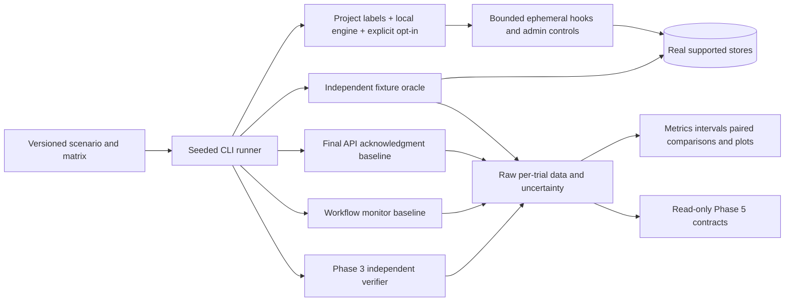
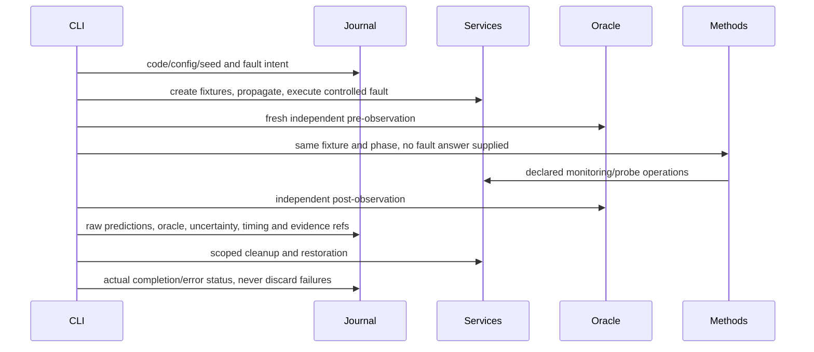

# Phase 4 research protocol

Research question: can direct fault-aware verification detect incomplete distributed deletion more effectively than faithful API/worker-acknowledgment and workflow monitors, while preserving uncertainty and paying a measured resource/latency cost? This is a hypothesis, not a novelty or superiority claim.

## Architecture and isolation


Normal Compose does not enable research faults. Use the explicit `compose.research.yaml` overlay, a project beginning `eraseproof-research`, APP_ENV=demo, and ERASEPROOF_RESEARCH_FAULTS=1. The driver checks configured and actual container labels, local Unix Docker context and loopback API bindings. It refuses an ordinary/unmarked project or a remote Docker engine. Default API ports cannot be shared with another stack: stop the ordinary stack before starting the isolated research project, preserving its volumes. No public fault API is added.

Runtime injection points are fixed `deletion.before_connector` and `deletion.after_connector`. They are no-ops unless all demo/test/isolation/subject gates match. Only ephemeral workers receive hook configuration. Supported actions skip a target mutation while normal durable success recording proceeds, exit after an actual external mutation before acknowledgment, or report an error after an externally applied mutation. This last case produces legitimate operational failure with possible actual absence; it tests baseline false alarms rather than weakening baselines.

The driver also supports actual service pauses, queue-consumer interruptions, confirmed duplicate/stale create publication, PostgreSQL constraint rollback, residue injection, a delayed legacy writer, worker SIGKILL, missing verifier capability and supported order/deletion races. Profile update APIs remain unsupported; update/version-2 messages are not invented as working application features. Stale supported create events are tested against existing barriers. Forced delayed reindexing explicitly models an uncooperative legacy writer outside those barriers and does not claim the normal fences failed.

A PostgreSQL project lease prevents overlapping framework batches. A local file lock prevents two executors sharing a journal. Lease expiry is five minutes; no unsafe live-owner takeover exists. Fault intents are journaled before activation. Token-scoped 90-second watchdogs restore paused/stopped services if the runner is killed; superseded tokens cannot restore a later fault. Normal cleanup cancels its live watchdogs. A probe-lock fixture expires after 15 seconds. Only recorded fixture IDs, fixed keys and owned fault containers are cleaned; unrelated source records are not reset. Deletion/audit/erasure metadata is retained by explicit policy.

## Versioned scenarios and workload matrix
See `config/scenarios.v1.json`, `config/ci.v1.json`, and `config/extended.v1.json`. The catalog describes initial state, category, affected stores, activation, expected observations, recovery, deadlines and seed source. Expected labels are hypotheses/documentation; the oracle and evaluated methods do not read them.

The CI matrix covers small (one customer/two orders), medium (three/four), and larger (six/eight) fixtures. It includes single and interacting faults, normal retention, false success in cache/search, analytics and order residue, outages, pending delivery, delayed reappearance, duplicate/reordered events, a crash after mutation, ambiguous error replies, verifier crash, a missing adapter, transaction rollback and supported write races. Several key scenarios repeat seeds 101 and 202. Other scenarios have only one CI replicate: report that limitation, not a confident percentage.

The extended matrix uses more seeds, repetitions and longer consistency windows. Its configuration is provided but it is **unexecuted unless a recorded result says otherwise**. CI is a manageable subset rather than a Cartesian product. Seeded pseudorandom generation controls amounts, fixture naming, action delay and plan order (fixed plan-order seed 20261107). API-assigned UUIDs, OS scheduling and measured timing are not bitwise deterministic; actual identifiers/timelines are recorded. Fixed seeds do not remove concurrency variance.

## Baseline definitions and fairness
- **api_ack:** trusts the final deletion API result, not HTTP 202 acceptance. COMPLETED_REPORTED predicts absence; PARTIALLY_FAILED/FAILED raises an operational incompleteness alarm (scored as a positive prediction); an active/unknown operation abstains. Such an alarm is not direct residue evidence.
- **workflow:** checks the full six-target inventory, terminal task states and latest attempt outcomes. Completed recovered retries are accepted. Required terminal failures raise an incompleteness alarm; insufficient inventory/pending work abstains. It makes no store queries.
- **eraseproof:** calls the real Phase 3 verifier and maps actual scoped outcomes. Pending, inconclusive and unsupported outcomes abstain. No scenario identifier, injected action or oracle label is sent to the verifier.

These are internal architectural monitors, not OneTrust/Transcend/BigID equivalents. No competitor performance results are fabricated. A fair third-party comparison would require compatible connectors, equal retention/scope policy, accessible deployment and comparable output semantics; that is not established here. API and workflow predictions may coincide because this backend atomically enforces completion invariants. No artificial corruption is added merely to make baseline B look different.

All methods receive the same synthetic customer, workload and observation phase. API/workflow consume the same operational metadata snapshot at method invocation; they receive no oracle or store values. The independent verifier reads actual stores. Oracle observations bracket the method evaluation; a changing oracle classification becomes pending rather than an invented stable label. Data remains frozen during stable decision phases. Method timing is call-to-outcome from the shared phase, not a commercial end-to-end SLO comparison.

## Independent ground truth
`research_oracle.py` is separate from production adapters, verdict aggregation and baseline code. It uses privileged fresh reads of the fixture's known customer/order/event/document/key identifiers. It does not query the verifier's verdict or use the catalog's expected result as truth. The harness knows order IDs from creation responses independently of the verifier's manifest. Search uses direct known document reads; Redis inspects the known fixture footprint rather than reusing the evaluated SCAN adapter. All six stores are checked.

The oracle distinguishes ABSENT, RESIDUAL, PENDING, UNAVAILABLE and UNSUPPORTED. An inaccessible target is not labeled absent because its assigned fault expected absence. Positive available residue can establish a positive even when another store is unavailable. Negative truth requires all six successful checks within the declared fixture scope and an eligible settled phase. The oracle is complete for controlled fixture locations, not arbitrary unknown copies in a production system. Permitted facts and exact erasure markers are classified explicitly; removing an identifier alone does not establish anonymity.

## Metrics and statistics
Positive means eligible residual data. TP/FP/TN/FN are calculated only for binary oracle truth and conclusive method predictions. Precision=TP/(TP+FP), recall=TP/(TP+FN), FPR=FP/(FP+TN), FNR=FN/(FN+TP). Zero denominators remain undefined. Abstentions, pending/inconclusive/unsupported outcomes, unknown-oracle rows and clearance under unknown truth are separately reported. Full positive detection yield uses every known-positive oracle row, including abstentions. Failed, timed-out and interrupted physical attempts remain in raw data and trial-completion counts; they are not successful negatives or silently dropped.

Summaries include sample counts, mean/median/nearest-rank p95 latency, variance, recorded data-plane queries, per-category outcomes, deletion latency, retries, recovery/reappearance detection and actual Docker CPU/memory snapshots. Snapshots describe the shared stack, not peak memory or causally attributed per-method CPU. Query counts are durable verifier records and exclude control-plane/oracle queries and uncommitted probes lost during a crash.

Proportion intervals use the [Wilson score method](https://www.itl.nist.gov/div898/handbook/prc/section2/prc241.htm), not a tiny-sample Wald approximation. Paired predictions share exact fixture phases; exact discordant-binomial calculations are exported. Offline analysis also resamples whole physical trials with a fixed seed to retain within-trial correlations. Trial-weighted cluster-bootstrap differences and pooled per-decision rates have different estimands and are labeled accordingly. Selected scenarios, correlated phases and few repeats prevent claims about population accuracy or general statistical superiority. Results are descriptive evidence, not preselected target percentages.

## Durable execution and replay
A journal is written by fsync + atomic replace, with a canonical integrity digest. PostgreSQL mirrors experiment/trial state for read-only research APIs. Resume requires the same committed code and configuration; an existing dataset cannot be overwritten by a new run. Incomplete prior attempts become INTERRUPTED and are retained, their recorded faults are cleaned, and a new physical attempt is created for an unfinished logical slot. The original absolute batch deadline is preserved. Remaining planned but unexecuted trials are explicitly counted.

This is not privileged-operator tamper protection: an administrator can rewrite journals/databases and hashes. Keep external artifact digests if provenance matters. A live project lease is not stolen; after an executor crash, allow its five-minute lease to expire before resuming. Watchdogs bound infrastructure disruption while waiting. Local disk loss, malicious administrators and external competing workloads are outside the isolation guarantee.



Failure minimization is deliberately deferred: replaying multi-fault candidates would multiply expensive real trials and non-monotonic race effects require a carefully defined preservation predicate. The bounded runner, action catalog and recorded timelines provide the necessary inputs for Phase 4 follow-up delta debugging; no unexecuted minimization result is claimed.

## Exact commands
Fresh isolated stack:
```sh
python3 scripts/configure_demo.py
# Stop an ordinary stack first if it already owns ports 8000–8006; keep its volumes.
export COMPOSE_PROJECT_NAME=eraseproof-research
export COMPOSE_FILE=compose.yaml:compose.research.yaml
docker compose up --build -d --wait --wait-timeout 240
python3 -m venv .venv
. .venv/bin/activate
pip install -c requirements.lock -c requirements-benchmark.lock -e '.[dev,benchmark]'
set -a; . ./.env; set +a
python scripts/seed.py
```
Existing .env files are preserved; add a fresh independent RESEARCH_TOKEN for the read-only result API. Fault activation is CLI-only and still requires the explicit gate below.

One false-success scenario:
```sh
ERASEPROOF_RESEARCH_FAULTS=1 python -m eraseproof.research_runner \
 --project eraseproof-research --scenario false_ack_cache --seed 101 --tier small --output work/phase4-one
python -m eraseproof.research_report work/phase4-one/dataset.json --output work/phase4-one-report
```
CI-scale and extended matrices:
```sh
ERASEPROOF_RESEARCH_FAULTS=1 python -m eraseproof.research_runner \
 --project eraseproof-research --matrix research/phase-4/config/ci.v1.json --output work/phase4-ci
ERASEPROOF_RESEARCH_FAULTS=1 python -m eraseproof.research_runner \
 --project eraseproof-research --matrix research/phase-4/config/extended.v1.json --output work/phase4-extended
# Budget, concurrency, method selection, safe longer settling, repeats:
ERASEPROOF_RESEARCH_FAULTS=1 python -m eraseproof.research_runner \
 --project eraseproof-research --scenario normal_retention --seed 101 --tier medium \
 --repeats 2 --consistency-profile extended --concurrency 2 --max-seconds 300 --methods api_ack workflow eraseproof --output work/phase4-repeat
```
Resume uses exactly the same flags/configuration plus --resume after a dead executor's lease expires. All prior failed attempts stay visible. The protocol does not cherry-pick a seed to replace an unfavorable completed trial.

Exports and inspection:
```sh
python -m eraseproof.research_report work/phase4-ci/dataset.json --output work/phase4-generated
# dataset.json: raw trials/ground truth/predictions; decisions.csv: flat export;
# aggregate.json/results.md: metrics and statistics; PNG/PDF: measured plots.
curl -sS http://localhost:8006/v1/research/experiments -H "X-Research-Token: $RESEARCH_TOKEN"
curl -sS http://localhost:8006/v1/research/scenarios -H "X-Research-Token: $RESEARCH_TOKEN"
```
Read-only endpoints also expose /experiments/{id}, /experiments/{id}/trials and /experiments/{id}/summary with bounded pagination/size. A trial links its fault timeline, oracle snapshots, baseline predictions, verifier run UUID, per-store outcomes and evidence file. Direct verification report endpoints retain their own authorization. No research HTTP endpoint accepts a mutation or starts an experiment.

To demonstrate normal deletion, incomplete deletion, a workflow-success contradiction and detection, run normal_retention followed by false_ack_cache or false_ack_search; inspect their raw phases and generated comparison. The CI matrix executes these against real infrastructure. The framework restores only its fixtures. A full disposable reset is explicit and destructive:
```sh
docker compose down -v --remove-orphans
```
Do not use that command for an ordinary or shared project. Baseline Phase 1–3 integration tests remain enabled. CI runs them and the measured research matrix; data/documentation-only commits still validate raw datasets and unit tests while source changes rerun Docker. Curated actual executions live under results/ with generated figures under generated/; unexecuted configurations never masquerade as results.
